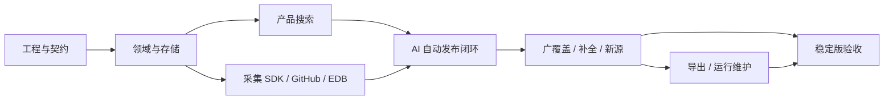

# 漏洞知识库开发计划

版本：v1.1  
制定日期：2026-11-01  
设计基线：[漏洞知识库爬虫与存储系统设计 v0.4](./漏洞知识库爬虫与存储系统设计.md)  
当前状态：实施中（2026-11-01）。下列任务状态仅在达到各自验收标准后勾选；代码进展和环境限制记录于第 8 节。

## 1. 交付目标与执行原则

交付一套小团队共享的知识库：**输入产品名称 → 确认产品 → 查看全部已收录可复现漏洞 → 获取适用版本、复现步骤和 PoC/EXP**。不强制先选公司或输入版本。

在材料门槛内尽可能扩大收录。默认历史回填、增量发现和自动补全持续运行，不设固定收录总数；关注产品只提高优先级。AI 承担实体映射、材料审核、补全规划及关联评估，合格结果自动发布，人工纠错与实验验证均为可选增强。

执行原则：

1. 先交付产品搜索与真实来源入库闭环，再扩覆盖与吞吐；不先完成所有外围功能才验证主流程。
2. 来源插件输出统一数据，不直接发布或修改搜索逻辑。首批 GitHub/Exploit-DB 也遵守相同契约。
3. 同一漏洞保留多个 PoC/EXP 实现及各自适用范围；同 CWE 不同产品或不同缺陷分别收录。
4. 材料就绪、原始成功证据、独立复现成功分级展示。无独立运行日志不自动拒收合格材料。
5. 搜索使用本地索引，不等待模型；预算或模型故障只暂停相应新审核任务。
6. 每个任务完成时提交实现、必要验证结果和遗留限制，再勾选状态；功能仅有 mock 时注明，不作真实接入验收。

本计划不要求爬虫运行下载代码或测试原报告目标地址。独立实验执行器、互联网资产扫描、赏金自动提交不属于首个稳定版本。

## 2. 需求追踪与范围

### 2.1 核心需求编号

| 编号 | 必须实现的行为 | 设计依据 |
| --- | --- | --- |
| R1 | 只输入产品名即可搜索，支持别名/同名消歧、可选公司/版本和完整分页 | §2.6、§4.3、§11 |
| R2 | 广覆盖历史回填与增量并行，配额超额暂缓不丢弃，明确覆盖限制 | §3、§8、§20 |
| R3 | 有 PoC/EXP 或完整流程且通过 G1～G6 才发布，非关键缺项不阻塞 | §2.4～2.5、§6、§10 |
| R4 | 新源通过映射配置或独立插件接入，复用审核、搜索和导出 | §8.2、§19 |
| R5 | 可配置模型 URL/名称/Key，自动评估、补全、审核和发布，保留证据 | §18、§20.3 |
| R6 | 稳定漏洞/产品/材料身份，多实现、多来源、字段证据及可撤销关联 | §5～6、§9 |
| R7 | 版本判断遵循已支持的生态语义，未知/冲突明确标注 | §7 |
| R8 | 团队访问、Secret 管理、鉴权下载与抓取/展示隔离 | §11.4、§13、§18.5 |
| R9 | 生成 Markdown、分类目录、全部正式索引及来源 sidecar，导出代次一致 | §5、§10、§12 |
| R10 | 作业恢复、监控、降级复核、备份恢复及性能验证 | §8、§9.5、§14～15、§20 |

### 2.2 首个稳定版本与后续扩展

| 范围 | 本轮计划 |
| --- | --- |
| 必交付 | 产品检索、GitHub 实际材料/索引、EDB、来源 SDK、通用 JSON/Feed 映射、可配置 AI、自动发布、多实现、增量/回填、自动补全、账号权限、Markdown、监控和备份 |
| 同阶段推进、按来源能力交付 | Sploitus 探测及已验证发现通道；GHSA 补全；选定厂商公告/技术分析映射；必要的动态页面获取 |
| 后续增强 | 更多厂商/公开知识库、Nuclei/Metasploit 专用解析器、OSV/NVD 补全、更多生态比较器 |
| 首版不要求 | 私有报告权限体系、独立实验执行器、资产/SBOM 导入、向量检索、多团队租户、分布式搜索集群 |

Sploitus 未确认接口能力不阻塞主线。通用 JSON/Feed 接入能力必须交付并以一个不同于 GitHub/EDB 的来源验证，不能只写一个接口定义。

## 3. 里程碑、依赖与工期参考

### 3.1 里程碑表

以下按 **1 名熟悉 Python 的全栈开发者、配合 AI 编程工具**估算，单位为净开发人日。总计约 **30～46 人日，即 6～10 个工作周**；这是排期参考，不是交付承诺。真实来源限制、模型兼容性和数据歧义会影响工期；历史数据回填等待时间单独计算。

| 里程碑 | 结果 | 前置 | 参考人日 | 退出条件 |
| --- | --- | --- | --- | --- |
| M0 工程与契约 | 可启动的开发环境、固定 Schema/样本和模块边界 | 无 | 2～3 | 配置、迁移、标准对象及测试样本可用 |
| M1 领域与存储 | 产品—漏洞—材料、对象存储、候选/发布状态机 | M0 | 3～5 | 能幂等导入、修订和关联受控样本 |
| M2 产品搜索 | 网页输入产品名可查漏洞、步骤和材料 | M1 | 3～4 | 受控样本搜索通过，权限和材料下载有效 |
| M3 采集与首批主源 | 来源 SDK、持久队列、GitHub 与 EDB 试采 | M1 | 5～8 | 两个真实主源可断点采集并生成统一候选 |
| M4 AI 自动发布闭环 | 模型配置、材料审核、映射、证据校验和索引更新 | M2、M3 | 4～6 | 至少一个真实材料自动通过审核并在网页可查 |
| M5 广覆盖与扩源 | 回填/增量公平调度、自动补全、新来源接入 | M3、M4 | 5～8 | 覆盖可观测，新增源不修改业务核心 |
| M6 导出与运行维护 | Markdown 代次导出、复核降级、任务/管理页及备份 | M5 | 4～6 | 可导出可恢复，降级和材料权限一致 |
| M7 稳定版验收 | 质量、故障、权限、性能、扩源和部署验收 | M5、M6 | 4～6 | 完成第 6 节的稳定版发布门槛 |

M2 的受控数据仅验证搜索功能；M4 完成后才可称为“真实来源自动入库的早期可用版本”。M5 继续运行实际回填，不能将压测数据计入真实收录量。



单人建议顺序为 M0 → M1 → M2 → M3 → M4 → M5 → M6 → M7。多人实施时可在契约固定后分别开发搜索、采集和模型模块，仍按依赖集成，不依靠临时修改共享 Schema。

### 3.2 优先级与任务状态

- P0：早期主流程和首个稳定版本必须完成。
- P1：早期可用版本后补齐，稳定版需要完成已明确的通用能力；受外部能力限制的单独来源如实记录。
- P2：后续增强，不影响首个稳定版本发布。

任务清单使用 `[ ]` 表示待完成；开始后可以另记录进行中、阻塞原因和验证结果。只有通过该项验收后才改为 `[x]`。一个外部来源被阻塞不等于整个里程碑所有任务被阻塞。

### 3.3 Agent 执行与进度更新约定

每次接手先阅读本节、第 3.4 节、目标任务和对应设计章节，再检查现有代码、迁移、配置及第 8 节最近记录。以代码和实际命令结果为证据；历史记录是当时的快照，不作为当前能力证明。已有代码可以跨里程碑复用，依赖项未验收时允许并行实现，但不得提前宣称下游任务或里程碑完成。

1. 选取最靠前、依赖明确且可独立交付的任务或子步骤；优先打通产品搜索和真实材料入库闭环。开始时在第 3.4 节标注进行中及下一步，避免每轮仅做分散的小改动。
2. 根据任务的交付与验收逐项实现；需要接口或数据结构时先检查现有契约及迁移，不能通过修改旧迁移依赖当前模型来掩盖已有数据库的升级问题。
3. 完成实现后执行与该变更相称的检查，并记录命令、环境、结果及未执行原因；区分静态检查、离线样本、真实来源/模型和部署验证。不得把模型判断、成功导入或脚本可运行等同于独立实验成功。
4. 只有任务的全部交付与验收已满足，才将第 4 节对应框改为 `[x]`，同步在第 3.4 节更新状态，并在第 8 节追加完成记录：任务 ID、变更文件、验证命令与结果、真实依赖、限制和下一项。部分完成时保留 `[ ]` 并记录明确的剩余工作。
5. 无凭据、来源限制或环境缺失只阻塞依赖它的验收；记录已完成的独立工作、阻塞条件与恢复方式，继续其他可执行任务。离线 fixture 和 mock 不冒充真实采集或真实模型结果，密钥不写入日志、样本和文档。

状态口径：`未开始` 表示没有可用实现；`进行中` 表示已有部分实现或正在修改；`待验收` 表示交付代码已齐但验收未全部通过；`已完成` 必须与第 4 节 `[x]` 一致；`外部阻塞` 必须指明具体条件。第 3.4 节是当前快照，第 8 节是只追加的执行记录；每次完成任务或状态改变时同时更新，避免依赖聊天记录恢复上下文。

### 3.4 当前任务快照与建议顺序

截至 2026-11-02，代码已有跨阶段原型；T001～T003 已按各自验收记录完成。以下是基于仓库代码和第 8 节记录的工作清单，不代表真实来源已采集成功。

| 任务 | 当前状态 | 下一个可执行步骤 |
| --- | --- | --- |
| T001 | 已完成 | 干净 `uv sync --locked`、SQLite Web/Worker、存活与 DB 就绪/不可用区分已验证；Compose 配置已解析。Docker 构建与 PostgreSQL Compose 运行留在 T604。 |
| T002、T003 | 已完成 | v1.0.0 JSON Schema、领域模型、原因码和双状态轴已固定；18 项离线回归通过。下一步 T101：基于契约实现迁移与仓储，并检查现有迁移历史。 |
| T101 | 已完成 | 迁移 0001 已冻结为静态历史快照；0003 增加规范别名/标识、材料产品关系、对象清单、发布 outbox 和修订号。幂等仓储与 SQLite 全新升级通过。 |
| T102 | 已完成 | 候选/正式 SHA-256 命名空间、审核通过时原子提升、对象登记、原文件名 side metadata、受引用保护的注册/未登记孤儿回收和旧 key 只读兼容均已实现；对象测试通过。 |
| T103 | 已完成 | 统一发布服务校验完整材料、G1～G5、服务端 G6、对象哈希和产品级适用关系；发布/撤销事件与修订在事务内写 outbox。31 项累计回归通过。 |
| T104 | 已完成 | 独立别名/标识表与仓储已完成；SemVer/PyPI 比较器按漏洞版本与材料适用版本共同过滤并保留 unknown。37 项累计回归通过。 |
| T201 | 已完成 | 产品建议/别名标识、版本筛选、稳定游标、产品漏洞/材料/详情 API 已用真实路由与 SQLite fixture 验证。 |
| T202 | 已完成 | 搜索工作台、详情及适用材料展示已实现；产品 ID 消歧、键盘/输入法、筛选 URL/历史恢复和过期请求保护已核验。 |
| T203 | 已完成 | viewer/editor/admin 权限、登录会话、CSRF、候选/撤销材料下载、Secret 脱敏及 HTML/Markdown 外部内容防护已验证。 |
| T301～T305 | 进行中 | 完善租约围栏、共享传输/限速、来源契约和断点恢复；分别记录 GitHub 与 EDB 的真实只读试采。 |
| T401～T404 | 进行中 | 先补齐长材料覆盖、引用和 G6 服务端校验，再做预算/重试及真实模型自动发布闭环。 |
| T501～T704 | 未完成，部分已有原型 | 按依赖推进调度、补全、扩源、导出和运维；覆盖页及导出代码见第 8 节，不能视作验收完成。 |

当前主要剩余工作：

- T201～T203 构成可查看的本地搜索与权限 Demo，使用 SQLite 和受控/合成数据验证；尚未接入真实来源材料，不能据此声称已有真实漏洞覆盖或真实模型自动发布。
- 搜索工作台已通过模板/API 集成和前端语法检查，尚未执行真实浏览器多尺寸视觉验收；前端交互行为按实现检查并由 API/页面契约测试覆盖。
- 下一批按 T301/T302 → T303～T305 → T401～T404 推进真实来源采集和审核闭环，再推进 T501 之后的覆盖扩展与运维验收。每个任务按自己的验收门槛完成，不因代码存在而勾选。

## 4. 实施任务清单

### M0 工程与契约

- [x] **T001｜P0｜建立工程骨架与可重复环境**
  - 依赖：无。按 Python/FastAPI、服务端模板、PostgreSQL 和本地对象卷建立应用、Worker、调度及配置入口；固定依赖和镜像版本。
  - 交付：项目元数据、示例环境配置、Compose 开发定义、启动说明、健康检查；配置示例不含真实密钥。
  - 验收：干净环境按锁文件安装后可启动本地 SQLite Web/Worker；`/healthz` 区分进程存活，`/readyz` 区分数据库就绪；Compose 配置和环境示例可解析。Docker 镜像构建和 PostgreSQL Compose 运行在 T604 验收。追踪：R8、R10。

- [x] **T002｜P0｜冻结跨模块数据与状态契约**
  - 依赖：T001。定义产品/别名、漏洞、材料实现、产品级适用关系、来源断言、三档证据、G1～G6 及发布修订 Schema。
  - 交付：`src/vuln_kb/domain/contracts.py` 中的 Pydantic v2 标准对象、`schemas/contract-v1.json` 版本化 JSON Schema、`domain/states.py` 双状态轴转换表、稳定原因码及 blocking/retryable 策略。G6 只允许服务端在审核结束后计算；模型输出仅包括 G1～G5。材料与来源状态独立。
  - 验收：就绪无日志、完整手工过程、关键缺项、非关键缺项、版本未知、多产品多实现有明确字段/表示；正式发布对象必须含至少一个已批准材料，材料需声明产品适用关系；实验等级不由 AI 输出自行升级。Schema 与模型生成结果一致性由 T003 回归检查。追踪：R3、R6、R7。

- [x] **T003｜P0｜建立受控正反样本与验证入口**
  - 依赖：T002。保存可重复的来源对象解析、产品映射、材料审核及搜索预期样本；包括空仓库、失效链接、同名产品、假引用、重复转载、多产品多实现。
  - 交付：`tests/fixtures/admission_cases.json`、`tests/test_contract_fixtures.py`、`tests/test_search_fixtures.py` 和 `tests/README.md`；使用 Python 标准库 unittest，不需安装 pytest。样本只含合成数据，不执行外部代码。
  - 验收：`uv run python -m unittest discover -s tests -v` 离线运行；覆盖 schema 一致性、现有确定性材料引用校验、产品消歧、内容哈希去重、状态与搜索；不调用任何网络/模型、不测试原报告目标。在线验证保持为独立显式验收。追踪：R1、R3、R4、R5。

### M1 领域与存储

- [x] **T101｜P0｜实现数据库迁移与规范仓储层**
  - 依赖：T002。创建组织、产品/别名/标识、漏洞、影响、来源/修订、材料/复现包、产品材料关系、审核和作业基础表。
  - 交付：可追踪迁移、唯一键/外键/索引、统一仓储操作；Schema 不随每个新站点另建业务表。
  - 验收：同来源、同对象重复导入幂等；一文多漏洞、一漏洞多产品、多实现不丢失。追踪：R4、R6。

- [x] **T102｜P0｜实现不可变对象和材料获取存储接口**
  - 依赖：T001、T002。实现流式暂存、大小限制、SHA-256、候选/正式命名空间、原始文件名元数据及引用关系。
  - 交付：对象接口、写入失败处理、孤立对象回收基础能力；不运行下载代码。
  - 验收：中断无半成品正式对象；同字节多来源共享对象且来源不丢；路径不能由远程文件名任意指定。追踪：R6、R8、R10。

- [x] **T103｜P0｜实现候选、材料和发布状态机**
  - 依赖：T101、T102。按材料实现保存审核资格，至少一个实现合格即可发布；发布修订与 outbox 同事务。
  - 交付：统一发布/撤销/重审服务，普通查询的发布过滤规则；受控样本可导入已标注预期状态。
  - 验收：只有摘要不能发布；增加待审实现不下架既有有效实现；撤销最后一个适用材料时产品结果同步失去可复现资格。追踪：R3、R6、R10。

- [x] **T104｜P0｜实现产品身份、别名及版本引擎基础**
  - 依赖：T101。支持标准 ID、组织角色、包/仓库标识、别名证据和材料适用关系；建立可扩展版本比较接口。
  - 交付：首批 SemVer/PyPI 比较方案及原文范围保留；其他方案返回 unknown，不作字符串排序替代。
  - 验收：同名产品不误并；预发布、不连续区间、开闭端点及未知发行版有固定预期。首批比较器不覆盖所有生态，限制对用户可见。追踪：R1、R6、R7。

### M2 产品搜索与访问

- [x] **T201｜P0｜实现产品检索投影与查询 API**
  - 依赖：T101、T103、T104。建立产品建议、产品漏洞列表、材料列表及知识详情 API，按已发布产品—漏洞—材料关系检索。
  - 交付：名称/别名精确检索与模糊建议、可选版本筛选、稳定游标分页、三个独立数量口径。
  - 验收：不选公司/版本仍能遍历全部合格记录；同名产品可消歧；其他产品的 EXP 不冒充本产品可用材料。追踪：R1、R3、R6、R7。

- [x] **T202｜P0｜实现搜索工作台与详情页**
  - 依赖：T201。按设计 §11 的视觉规格实现搜索、自动补全、筛选标签、材料展开、复现步骤/来源及验证等级。
  - 交付：键盘可操作的网页，URL 保存查询，加载/失败/空结果状态；中文输入法结束后再请求建议。
  - 验收：旧请求不会覆盖新筛选；刷新/返回恢复状态；材料就绪档默认可见，方法页签不混入具体漏洞总数。追踪：R1、R3。

- [x] **T203｜P0｜实现团队登录、角色与材料下载**
  - 依赖：T101、T102、T103。实现管理员创建账号、viewer/editor/admin、会话、写操作保护及按材料 ID 鉴权下载。
  - 交付：账号管理和统一授权依赖，HTML/Markdown 清理、附件响应、Secret 脱敏规则。
  - 验收：普通用户不能读取候选材料/管理密钥；文件路径不能越界；降级材料不再下载；外部 HTML/代码预览不能执行脚本。追踪：R8。

### M3 持久采集与首批主源

- [ ] **T301｜P0｜实现持久任务、租约与共享传输**
  - 依赖：T101、T102。实现领取/续租/租约令牌、退避、每主机限速、重试/死信、网络超时和下载目的地址检查。
  - 交付：采集执行器、错误类别、条件请求及调度选主基础；不能在 Web 多进程启动时重复整轮调度。
  - 验收：Worker 崩溃可重领、旧租约不能覆盖新结果；429 服从重试时间；重定向不能访问被禁止地址。追踪：R2、R8、R10。

- [ ] **T302｜P0｜实现来源 SDK、注册与配置契约**
  - 依赖：T002、T301。实现 manifest/probe/discover/fetch/parse/normalize_error，Schema 校验及标准传输依赖注入。
  - 交付：Adapter 注册、配置 Schema/Secret 字段、能力报告、插件样板和契约检查入口。
  - 验收：插件不能自行发布、跳过公共限速或推进未处置水位；不兼容契约版本可识别；未支持能力如实返回。追踪：R4、R8、R10。

- [ ] **T303｜P0｜接入 GitHub 材料仓库与 PoC 索引**
  - 依赖：T302。读取固定 commit 的目录/文件、识别材料和依赖，解析索引中的原仓库引用并自动登记候选。
  - 交付：两个来源类型及解析样本，repo ID/commit/path 来源定位、HEAD 增量和去重。
  - 验收：处理 tree 截断、仓库重命名、fork 和多语言材料；配额超额保留游标；不默认执行仓库脚本或跟随 submodule。真实只读试采形成候选记录。追踪：R2、R4、R6。

- [ ] **T304｜P0｜接入 Exploit-DB 索引与材料**
  - 依赖：T302。按表头解析官方仓库索引，取得选定文件，记录 EDB-ID、固定修订、原文和材料来源。
  - 交付：EDB 适配器、多版本/多附件样本及索引增量游标。
  - 验收：索引变化不依赖固定列号；相同材料通过不同发现源不重复存储；无法取得的二进制明确缺失，不伪造完整状态。追踪：R2、R4、R6。

- [ ] **T305｜P0｜打通来源解析到规范候选的导入**
  - 依赖：T103、T104、T303、T304。将 ParsedDocument/ClaimDraft/MaterialRef 导入候选层，区分产品 owner 与 PoC 作者，保存证据定位。
  - 交付：来源修订、材料单元、缺项与待审核任务；解析失败可重解析而非删除快照。
  - 验收：一篇材料多个漏洞不误并、同漏洞多个实现不覆盖；不能因来源自称 verified 就直接发布。追踪：R3、R5、R6。

### M4 可配置 AI 与真实自动发布闭环

- [ ] **T401｜P0｜实现模型 Provider、设置页及能力测试**
  - 依赖：T002、T203、T301。实现兼容协议 Adapter、base_url/model_name/Key 配置、Secret 注入/轮换和合成测试。
  - 交付：连接配置版本、鉴权/模型/JSON 能力检测；模型主机白名单与爬虫目的地址策略分离。
  - 验收：区分 401、模型不存在、超时及结构能力不支持；Key 不回传浏览器、不进日志/导出；未通过能力测试的配置不能自动发布。追踪：R5、R8。

- [ ] **T402｜P0｜实现审核输入、输出及证据验证**
  - 依赖：T002、T305、T401。按材料单元构建完整上下文，长材料分块覆盖，验证 G1～G5、引用位置、材料哈希和 blocking/non_blocking。
  - 交付：版本化 rubric/prompt/输出 Schema、材料整理和产品映射任务；G6 由服务端验证结果计算。
  - 验收：假引用、截断、未审必要块和提示注入不得放行；无运行日志但条件/用法/影响依据齐全可获 material_reviewed。追踪：R3、R5、R6。

- [ ] **T403｜P0｜实现审核队列、用量和错误恢复**
  - 依赖：T301、T401、T402。实现幂等输入键、模型任务路由、并发/RPM、预算预留/对账、重试及结果缓存。
  - 交付：queued/running/completed/review_error/budget_paused、用量记录和重审入口。
  - 验收：模型失败/预算耗尽不自动 reject 或放宽条件；恢复后继续队列；相同成功输入不重复花费审核。超时重试可能重复计费的限制可见。追踪：R5、R10。

- [ ] **T404｜P0｜实现自动发布、投影更新与标签**
  - 依赖：T103、T201、T305、T402、T403。合格材料固化后事务提交审核/发布/outbox，更新产品投影及缓存；按适用实现聚合证据等级。
  - 交付：默认 ai + auto_publish 的完整路径，重审修订与材料级资格校验。
  - 验收：真实主源至少一个材料无需逐条人工批准即可在产品页出现，并可获取步骤/代码/来源；AI 不能声称独立实验 passed。追踪：R1、R3、R5、R6、R10。

**早期可用版本检查点：**T201～T203、T303～T305、T401～T404 共同通过。此时搜索已有真实材料，覆盖仍有限，页面必须显示来源及同步状态。

### M5 广覆盖、自动补全与新源接入

- [ ] **T501｜P0｜实现历史分区、增量与公平调度**
  - 依赖：T301、T303、T304、T404。枚举可访问历史分区，增量重叠去重，按来源/产品轮转及等待时间加权。
  - 交付：backfill/incremental/enrichment/maintenance 队列、权重和最低份额、分区水位及剩余引用。
  - 验收：关注列表外合格资料仍被处理；预算暂缓/空页不冒充 complete；增量持续到来时旧分区不会饥饿。追踪：R2、R10。

- [ ] **T502｜P0｜实现自动补全、冷队列及重开**
  - 依赖：T305、T402、T403、T501。AI 规划缺项，受限执行器按 CVE/EDB/包/原文引用取得补充材料并重审。
  - 交付：缺项原因、外链/文件/token 预算、deferred_refs、无进展计时和重开触发规则。
  - 验收：只有关键缺项阻塞相应实现；排队/预算暂停不计算无进展到期；新材料/解析器/策略变化可自动重开；不会无限循环联网或调用模型。追踪：R2、R3、R5、R10。

- [ ] **T503｜P0｜实现跨源归并、多实现与自动关系评估**
  - 依赖：T104、T305、T402。精确身份/哈希自动关联，AI 评估复杂候选，支持可撤销关系及版本化归并。
  - 交付：别名/关系证据、旧 ID 跳转、材料语言/框架/版本适用范围、回滚事件。
  - 验收：不同产品/缺陷的同 CWE 不合并；不同实现保留；有歧义先 separate/related，不要求人工裁决后才能发布合格材料。追踪：R2、R5、R6。

- [ ] **T504｜P0｜完成声明式 JSON/Feed 映射与扩源验收**
  - 依赖：T302、T305、T404。实现受限字段/分页映射、配置生成和离线样本验证；使用一个新增来源贯穿到搜索，导出复用在 T601/T703 集成验证。
  - 交付：Feed/JSON 通用适配器、映射示例、独立新增源配置和能力报告。
  - 验收：新增来源仅加映射/样本，不修改产品 API、领域仓储或 G1～G6 逻辑；无法枚举的历史范围标 partial。追踪：R4。

- [ ] **T505｜P1｜接入补充来源并探测 Sploitus**
  - 依赖：T302、T502、T504。接 GHSA 补全及选定公告/文章映射，探测 Sploitus 的实际公开发现通道；按需要增加动态获取器。
  - 交付：probe 结果、可用通道、覆盖限制及至少一类真实补充源；原始材料来源与 discovered_via 分开。
  - 验收：不能虚构 Sploitus API、HackerOne 正文能力或获取成功；单源不可用不阻断主源。来源能力变化能单独升级/回退。追踪：R2、R4、R6。

- [ ] **T506｜P0｜增加覆盖页、数量统计与零结果反馈**
  - 依赖：T201、T202、T501、T503。展示唯一漏洞/产品关系/合格材料数、已枚举分区、已处置/待处理、同步时间和限制。
  - 交付：产品 coverage API/页面、零结果说明、可配置的产品后台补全与冷却合并。
  - 验收：不称覆盖全网；未知分母不显示伪百分比；搜索本身不等待模型或为每次键入付费。追踪：R1、R2、R10。

### M6 Markdown、维护与部署能力

- [ ] **T601｜P0｜实现规范 Markdown 与分类索引**
  - 依赖：T102、T103、T404、T503。导出 report/record/reproduce/各实现说明、辅助复用卡、来源原文及 PoC/EXP sidecar。
  - 交付：开源/不开源/特殊/方法等浏览入口、产品索引和根 index.md/index.json；路径与显示名分开。
  - 验收：原件字节不修改，sidecar 和派生正文可追溯；普通公告/候选不冒充正式漏洞；多产品只生成入口而不重复维护正文。追踪：R6、R9。

- [ ] **T602｜P0｜实现一致代次发布与撤销处理**
  - 依赖：T601。固定修订清单、staging 构建、文件/链接/哈希校验、manifest/current 指针和旧代保留。
  - 交付：可靠导出作业、失败恢复、材料降级对应代次失效及重建。
  - 验收：中断不发布半成品；撤销材料不能继续从新下载入口取得；漏洞有其他合格实现时正确保留；已离线副本的时点限制可见。追踪：R3、R9、R10。

- [ ] **T603｜P0｜实现复核、冷对象回收和管理工作台**
  - 依赖：T103、T403、T502、T506。实现关键材料变更重审、材料级降级、对象引用检查、无进展候选清理及审计。
  - 交付：来源/审核/补全/错误/复核页签，可重试、启停、查看依据；人工接管为可选入口。
  - 验收：原链接失效但本地包完整不误下架；仍有引用的对象不回收；预算暂停任务不被当作不合格清理。追踪：R5、R6、R8、R10。

- [ ] **T604｜P0｜完成稳定部署、监控与备份恢复**
  - 依赖：T203、T301、T403、T602、T603。准备反向代理/HTTPS、数据卷、Secret 注入、结构化日志、指标和一致备份。
  - 交付：部署配置、运维说明、恢复脚本/步骤、导出/备份状态；临时无价值全文不进入长期备份。
  - 验收：干净环境可恢复规范数据、人工修正、材料和审核关系；核对哈希；凭据单独管理；完成 RPO/RTO 演练。追踪：R8、R9、R10。

### M7 稳定版验收

- [ ] **T701｜P0｜执行完整质量与产品检索验收**
  - 依赖：T404、T502～T506、T601～T603。使用冻结样本和真实采集样本，核对发布决定、产品映射、多实现、分页与证据等级。
  - 交付：正反样本结果、误放行/漏收与错误关联清单；记录模型、策略、来源修订和数据规模。
  - 验收：第 6 节门槛通过，非关键缺项不误拒；实际漏洞数量仅来自真实正式记录。追踪：R1～R7、R9。

- [ ] **T702｜P0｜执行故障恢复、权限与抓取边界验证**
  - 依赖：T301、T403、T501、T603、T604。注入领取/续租/写对象/发布/导出中断，以及模型失效、预算耗尽、索引积压和站点漂移。
  - 交付：恢复与授权验证记录，修复并回归发现的问题。
  - 验收：无丢失引用、重复发布或越权下载；未读必要材料不能被 AI 批准；模型故障时已发布搜索正常。追踪：R3、R5、R8、R10。

- [ ] **T703｜P0｜执行容量、性能和扩源兼容验收**
  - 依赖：T201、T302、T501、T504、T604。用 10 万级唯一漏洞及真实比例关系/正文/材料压测，测试新增不同结构插件。
  - 交付：查询/补全/索引延迟、吞吐、资源、配额和覆盖报告，以及新增源代码变更范围。
  - 验收：达成第 6 节性能目标；新源不修改搜索/发布核心；不能用空正文、小型单产品数据或压测假数据冒充真实覆盖。追踪：R1、R2、R4、R10。

- [ ] **T704｜P0｜整理首个稳定版本交付包**
  - 依赖：T701～T703。归档部署/配置/插件开发/模型配置/恢复/使用说明、数据库迁移、样本、验收报告及已知限制。
  - 交付：可复现构建与版本记录、运行参数、数据覆盖快照和后续 backlog。
  - 验收：按说明从新环境部署，真实产品查询、来源同步和恢复均可操作；未验证的来源能力明确标注，不以占位 Key 或测试结果代替在线验证。追踪：R1～R10。

## 5. 建议代码与文档组织

以下为待创建的结构约定，不表示目前已有这些文件；可在 M0 按实际框架调整名称，保留职责边界。

```text
vuln_lab/
├── pyproject.toml
├── src/vuln_kb/
│   ├── domain/                 # 产品、漏洞、材料、门槛、版本、状态机
│   ├── application/            # 导入、补全、审核、发布与导出用例
│   ├── infrastructure/         # PostgreSQL、对象存储、任务与 HTTP
│   ├── adapters/               # 通用来源 SDK、GitHub、EDB、配置式来源
│   ├── ai/                     # Provider、任务路由、证据/覆盖验证
│   ├── search/                 # 产品目录、查询、投影和缓存失效
│   ├── web/                    # API、鉴权、模板及交互脚本
│   ├── workers/                # 采集、AI、导出、调度入口
│   └── exports/                # Markdown、sidecar、manifest 生成
├── migrations/
├── configs/examples/           # 源/模型/调度示例，不含真实 Secret
├── tests/
│   ├── fixtures/
│   ├── domain/
│   ├── adapter_contracts/
│   └── integration/
├── deploy/
└── docs/
    ├── 漏洞知识库爬虫与存储系统设计.md
    ├── 漏洞知识库开发计划.md
    └── 后续部署、接入和验收说明
```

插件的逻辑目录遵守设计 §19：manifest、可选 mapping/adapter 和 fixtures。所有插件使用同一标准对象，领域层不能导入具体站点选择器、页面结构或模型 SDK。

## 6. 验证策略与发布门槛

### 6.1 验证分层

| 层次 | 重点验证 | 时机 |
| --- | --- | --- |
| 契约/领域 | 版本边界、实体身份、门槛、状态、去重和多实现适用关系 | 对应任务修改时 |
| 来源契约 | 分页、游标、限流、缺失、结构漂移、幂等及固定修订 | 每个来源接入/升级时 |
| 模型协议与证据 | 合成响应校验、真配置能力测试、错误引用/截断/预算恢复 | Provider/策略变更时 |
| 集成 | DB/对象/队列/outbox/投影/导出跨阶段一致性 | M4、M6 集成及故障修复时 |
| 网页流程 | 产品名直接查询、消歧、版本筛选、材料获取、中文输入与历史导航 | M2、M4、M7 |
| 真实来源和模型 | 少量真实只读试采及审核，与 mock 结果分开 | 有真实端点/凭据后、M4 和发布前 |
| 容量和恢复 | 查询延迟、调度吞吐、公平性、备份/恢复和索引重建 | M7，或有新瓶颈时 |

离线 fixture 通过不能证明真实站点可用；模型返回合法 JSON 也不能证明结论准确。报告分别记录真实接入能力、结构/引用合法率、样本误放行与漏收。大规模历史任务按吞吐估算等待时间，不纳入“单页查询响应时间”。

### 6.2 稳定版本必须达到

| 检查项 | 发布门槛 |
| --- | --- |
| 产品主路径 | 不选公司/版本即可查询受控正例集的全部已发布关联；同名可消歧，无固定 top-K 截断 |
| 材料门槛 | 无材料/关键缺项不能发布；合格代码无运行日志可标 material_reviewed；非关键缺项不阻塞 |
| 多实现 | 同漏洞各语言/框架/版本实现保留，适用关系与等级按本产品/版本展示 |
| 自动审核 | 有真实主源材料从发现到搜索无需逐条人工批准；失败/拒答/截断/假引用不能自动放行 |
| 来源可扩展 | 新 JSON/Feed 仅增加配置映射；不同结构来源只增加插件，不改产品搜索或发布核心 |
| 广覆盖 | 主源有历史分区与增量任务，配额暂缓不丢引用，关注列表外资料继续推进，剩余限制可见 |
| 数据追溯 | 所有正式材料有来源、修订/哈希、复现包和审核依据，派生步骤不冒充原件 |
| 下载/权限 | 降级或未授权材料不能下载；Key 不进入日志、浏览器存储、模型输入或导出 |
| 导出 | 正式索引/目录/材料对应同代修订，链接/sidecar/哈希有效，失败不发布半代 |
| 查询延迟 | 10 万级代表性数据、10 个并发会话下：产品 ID 列表 p95 < 500ms，复杂筛选 < 2s，详情 < 1s |
| 自动补全建议 | 公司/产品建议服务端 p95 < 300ms；端到端另计网络和 250ms 防抖 |
| 索引时效 | 正式发布到可检索延迟 p95 ≤ 60s；索引故障显示同步状态并可恢复 |
| 恢复 | 干净环境恢复后规范数量/材料哈希/审核关系一致；RPO ≤ 24h、RTO ≤ 4h，通过演练确认 |

性能指标是待验证目标，验收记录必须包含机器资源、数据库配置、正文/材料体积、冷热缓存条件及查询组合。未达标时先定位和修复，不直接通过增加空样本或减少返回关系使报告“通过”。

## 7. 外部配置、风险与处理

### 7.1 运行前需要的配置

| 项目 | 缺失时可继续的工作 | 必须具备后的验收 |
| --- | --- | --- |
| 模型 base_url、模型名、Key 和预算 | 离线协议/Schema、错误模拟、搜索、队列和引用检查 | M4 真实模型能力与自动发布 |
| GitHub 只读凭据、种子源及额度 | 解析样本、公开小量探测、SDK 开发 | 稳定回填吞吐及真实增量 |
| 部署主机、域名、HTTPS 和存储位置 | 本地开发、Compose、离线故障测试 | 生产登录、备份恢复和真实容量 |
| 新增补充源端点及实际能力 | 通用映射和契约 fixture | 至少一个真实新增源贯通 |
| Sploitus 可用公开通道 | 其他主源和补充源全部主线 | 该源的单独能力报告/适配验收 |

配置缺失不阻止编写非依赖部分，但不能将尚未运行的真实集成检查标为完成。密钥由部署配置注入，不写入设计、任务文档或 Git。

### 7.2 主要风险与应对

| 风险 | 处理原则 |
| --- | --- |
| 主源接口限流、搜索窗口或目录不能完整枚举 | 分区、游标、预算暂缓和覆盖说明；不把局部结果报成全量 |
| AI 误判、提示注入、低覆盖输入 | 证据/覆盖校验、固定正反样本、独立任务预算和版本化策略；错误可自动重审、人工可选纠正 |
| 为收录量而误关联产品或把同 CWE 误并 | 标准身份/断言证据、材料级适用关系、歧义保留和可撤销关联 |
| 模型审核成本成为吞吐瓶颈 | 哈希去重、已审结果缓存、任务路由、批量处理和预算限额；不降低门槛 |
| 候选过期策略导致合格材料漏收 | 系统排队不计无进展时间，冷队列保留固定定位及重开规则 |
| 站点结构或插件升级造成字段丢失 | 离线契约、少量试采、parser 版本、漂移告警/回退及来源故障隔离 |
| 广覆盖量大而网页变慢 | 产品投影与复合索引、分页、材料批量读取、缓存失效；查询不调用模型 |
| 新数据源每次修改核心 | M5/M7 强制检查新增代码范围；新增材料语义才允许版本化扩展核心契约 |

## 8. 执行记录与完成口径

建议按任务记录实现修订、验证证据和遗留项；文档中的开发计划不代替真实运行结果。

```text
任务 ID：Txxx
状态：未开始 / 进行中 / 已完成 / 被外部条件阻塞
实现：代码修订或变更说明
验证：样本、命令/检查及结果报告位置
真实依赖：来源/模型配置修订，是否仍为 mock
遗留：限制、下一任务或外部配置缺项
```

最终交付包括可部署代码、数据库迁移、配置示例、来源插件开发说明、模型设置说明、用户搜索说明、Markdown 导出、运维恢复说明与验收报告。数据量、来源覆盖和自动化率以实际运行报告为准；持续收录是部署后的长期作业，不以达到某个固定条数宣布“全库完成”。

### 8.1 首轮代码落地记录（2026-11-01）

以下为首轮时点的历史快照，后续变化以 8.2 及之后的记录和第 3.4 节为准。本轮已在仓库建立可继续开发的首个应用切片，**以下是代码现状，不代表稳定版任务通过验收**。因此任务框中的 `[ ]` 仍保留；未完成运行/真实来源验收的任务不能改为 `[x]`。

已落地的代码范围：

- Python/FastAPI 工程元数据、锁文件、环境示例、PostgreSQL Compose、Alembic 初始迁移、Web/Worker 独立进程、存活与 DB 就绪端点。
- SQLAlchemy 领域模型：组织、产品/别名字段、开源状态、漏洞/特殊主题、产品影响/版本范围、来源文档/不可变修订、材料变体、复现包、AI 审核、用户/会话、采集任务和覆盖分区。
- SHA-256 不可变对象写入/读取校验；账号会话、CSRF、viewer/editor/admin 最小权限、材料附件下载；管理员账号通过 CLI 或引导环境变量创建。
- 产品/公司/版本/关键词搜索、产品建议、详情和材料页；结果使用 offset 分页且不设固定总条数上限，版本匹配目前是原始范围字符串匹配，未完成语义化比较器。
- GitHub 公开仓库搜索/单仓库树遍历（含分页游标）、Exploit-DB CSV/材料发现、受限 RSS/JSON Feed 映射及 Python entry point 插件注册。
- 独立持久 Worker 任务、失败退避、分区发现/处理计数；未完成共享限速、公平队列、续租令牌及完整历史回填策略。
- OpenAI Chat Completions 兼容 AI 设置、Key 加密存储、能力探测、日预算/价格预留、结构化声明证据和服务器复核门槛；预算暂停保持候选并安排可恢复审核，不提供 PoC 执行。
- 按规范 UUID 生成 report/reproduce/field-guide/record/validation/source sidecar 和 PoC/EXP 附件；生成开源/不开源/待确认/特殊浏览入口、index.md/index.json、文件哈希 manifest 和 current 指针；PowerShell 备份入口，Web/Worker/DB Compose 配置。

本轮进行了 Python 语法编译、JavaScript 语法、TOML/YAML 解析和 Jinja 模板编译检查，均通过。依赖安装尝试在下载包阶段停滞并被中断；当时的环境未安装 FastAPI/SQLAlchemy，**应用启动、数据库迁移、浏览器/API 流程、Docker 构建、真实来源抓取、真实模型审核、性能/恢复演练均未运行**。没有把静态检查记为端到端验收。

稳定版仍需完成的主要任务：

- M0/M1：正反 fixture、状态/来源契约版本化、统一仓储层、完整对象暂存与垃圾回收、SemVer/PyPI 版本比较器。
- M2/M3：同名产品消歧/别名匹配、稳定游标搜索、完整账号管理流程、共享限速/条件抓取/租约恢复、HackerOne/GHSA/厂商补充源与 GitHub PoC 索引语义解析。
- M4：长材料分块覆盖、完整引用位置校验、审核幂等缓存/用量对账/能力回归、真实模型下无逐条人工审批发布。
- M5/M6：跨源可撤销关联和多实现完整性、自动补全/冷队列、来源公平调度、完整浏览入口、撤销/导出重建、冷对象回收、日志指标和备份恢复演练。
- M7：固定数据样本下质量、权限/故障、扩源、10 万级查询性能、索引时效和 RPO/RTO 结果报告。

首轮当时记录的下一步：安装依赖并启动本地环境；该步骤后续进展见 8.2，当前优先顺序以第 3.4 节为准。

### 8.2 后续实现记录（2026-11-01）

以下为本轮时点的历史记录，后续变化见 8.3 起及第 3.4 节；当时尚未有完整任务达到验收门槛：

- 对象存储新增 `put_chunks` 分块写入：边写边计算 SHA-256、默认限制 25 MiB、写入同文件系统临时文件并原子替换；超限、空对象或写入失败会清理暂存文件。环境变量为 `MAX_OBJECT_SIZE_BYTES`。
- 移除未被应用使用的 `uvicorn[standard]` 可选依赖；PostgreSQL 驱动改为 `postgres` extra，本地 SQLite 开发不必安装，Docker 构建显式安装该 extra。锁文件仍使用默认 PyPI 索引。
- 通过用户指定 SOCKS 代理及替代 PyPI 镜像安装了 SQLite 开发依赖。Python 语法编译、JavaScript 语法和锁文件一致性检查通过；应用模块成功导入。
- 使用本地 SQLite 完成 Alembic `0001_initial` 迁移；启动 Web 后 `/healthz` 返回 `ok`、`/readyz` 返回 `ready`、登录页返回 HTTP 200。该检查未覆盖 Docker/PostgreSQL 或登录后的完整业务流程。当前环境没有 Docker CLI，因此 Compose 构建和服务链路仍未验证。
- T102 仍为进行中：来源适配器当前以完整 `bytes` 返回快照，尚未端到端流式下载；正式/候选仍由数据库状态及引用区分，未增加独立对象命名空间或孤立对象回收。已完成的对象存储分块写入接口未达到该任务全部验收范围。
- M0 的 Compose/干净环境启动，M1 的幂等导入、跨来源去重和状态机行为仍待验证。没有真实来源抓取或真实模型审核；当前实现不能据此宣称已自动发布真实漏洞。

### 8.3 产品检索增量（2026-11-01）

- `/api/search` 已从 offset 查询切换为带 HMAC 签名的 keyset 游标；游标按发布时间（空值排后）、标题和记录 ID 稳定排序，并绑定查询筛选条件，损坏或跨条件复用返回 HTTP 400。
- 检索可匹配产品名、规范名和 JSON 别名；建议列表也搜索别名，保留同名产品的厂商信息，选中建议时同时填入产品和厂商。结果按漏洞记录聚合多条匹配产品关系，避免同一漏洞因为多个产品关系重复占结果位置。
- 补充指定产品的漏洞列表 API、漏洞详情 JSON API，详情只列出已审核材料，并返回适用产品/版本、复现说明、哈希及原始来源链接。
- 前端“加载更多”使用服务端游标，URL 仍保存筛选条件；请求中防止重复点击，并继续采用文本节点展示用户/来源文本。
- Python/JavaScript 语法检查和锁文件一致性检查通过。尚未用多页/同名/多产品 fixture 验证 SQL 结果，因此 T201/T202 仍未达到完整验收，任务复选框保持未勾选；不据此报告搜索数据准确率或性能。

### 8.4 Worker 租约增量（2026-11-01）

- Job 增加随机租约令牌及 Alembic `0002_job_lease_token` 迁移；任务领取通过带资格条件的原子更新完成，过期任务可重新领取。
- 长任务每 45 秒以独立数据库会话续租，完成/失败状态只允许持有当前令牌的 worker 写入，降低超时 worker 覆盖新领取者状态的风险；模型/代码的退避重试继续保留。
- Python 语法编译、SQLAlchemy mapper 配置和 Alembic revision graph 检查通过。尚未在多 worker 并发、worker 崩溃、续租数据库故障和过期重领场景验证；共享限速、每主机限流、重定向目的地址检查仍未实现，T301 保持未完成。

### 8.5 材料流式导入增量（2026-11-01）

- `RawSnapshot.content` 支持异步字节流；GitHub raw、Exploit-DB 文件和声明式 Feed 材料下载改为在 HTTPX 响应仍打开时按块产生内容，不再把完整响应拼接到内存。
- 公共导入层将流直接写入对象仓库暂存文件、计算 SHA-256 并施加统一 25 MiB 默认上限，来源适配器还可使用更严格上限。异常、空对象和超限会移除临时文件；对象完成后才将引用写入来源/修订/材料记录。
- Python 语法编译、JavaScript 语法及锁文件一致性检查通过。端到端网络流量、超限中断和数据库失败孤立对象回收尚未验证；T102 仍未覆盖孤立对象回收，保持未完成。

### 8.6 收录概况页面增量（2026-11-01）

- `/api/coverage` 增加已发布产品数及按任务状态/类型统计；搜索页新增收录卡片、来源分区同步表和待处理/运行中/失败任务说明。零结果仍展示库内数量和“无结果不代表不存在漏洞”提示。
- 页面明确不推算全网覆盖率，来源与错误文本使用 `textContent` 输出，不将外部来源内容作为 HTML 执行。搜索与概况查询均不调用模型。
- T506 中“产品后台自动补全与冷却合并”尚未实现，来源历史范围和配额也未形成完整覆盖度量，因此不勾选 T506。该页面增量待数据库样本及浏览器交互验证。

### 8.7 T203 安全界面增量（2026-11-01）

- 搜索、详情、管理模板去除内联事件属性，统一由同源 `app.js` 的事件委托处理；动态建议项改用 `addEventListener`。响应添加 CSP（禁止内联脚本、对象和跨站连接）、`nosniff`、防框架嵌入、Referrer 与 Permissions Policy。
- 静态复核现有访问路径：会话读取检查用户有效状态，管理/编辑 API 有角色依赖与 CSRF，候选和材料下载只查正式记录/已批准材料，对象 key 由 SHA-256 key 校验器解析，详情模板由 Jinja HTML autoescape 渲染。
- Python/JavaScript 语法、模板编译和 SQLAlchemy mapper 检查通过；模板/脚本中未发现内联事件属性。没有运行越权、撤销下载、路径穿越或浏览器 CSP 场景验证，因此 T203 暂不勾选。

### 8.8 开发计划可执行性修订（2026-11-01）

- 新增 Agent 接手、任务选择、验收和同步更新流程，以及当前任务状态与优先缺口；保留既有任务 ID、验收门槛和历史记录，未将原型改为已完成。
- 将首轮快照移至后续记录之前，标明过时内容的时间属性；最新状态以第 3.4 节和后续记录为准。此次只优化计划文档，不表示应用缺口已修复。

### 8.9 T104 版本比较器增量（2026-11-01）

- 新增 SemVer 与 PyPI/PEP 440 范围判断模块，支持 SemVer 比较符、caret/tilde、两个端点闭区间、OR 范围、预发布版本，以及 PyPI 比较符和逗号组合范围。未支持的生态、非法版本和无法解析的表达式统一返回 `unknown`。
- 将 `packaging` 声明为直接运行依赖并更新锁文件。经 SOCKS 代理完成 SQLite 开发环境的该依赖安装；Python 模块编译和依赖锁一致性检查通过。
- 比较器尚未接入产品生态识别、材料适用关系、搜索分页与结果解释，也没有固定边界样本验证，因此 T104 保持未完成；不得将此模块单独视为语义版本筛选已交付。

### 8.10 T001 工程环境完成记录（2026-11-01）

- 在全新 `.venv-t001` 中执行 `uv sync --locked --cache-dir .uv-cache --system-certs`，锁定项目及 29 个包安装成功，包含项目构建；该虚拟环境保留并由 `.gitignore` 忽略，供后续开发复用。
- 从该环境启动 `python -m vuln_kb.worker` 和 `uvicorn vuln_kb.main:app`，共同使用新的 SQLite 数据库；`/healthz` 与 `/readyz` 均返回 200，登录页返回 200。
- 用无效 SQLite 文件模拟数据库不可用：Web 进程启动成功，`/healthz` 返回 200，`/readyz` 返回 503。使用干净环境执行 `alembic upgrade head`，`0001_initial` 和 `0002_job_lease_token` 均完成；`pyproject.toml`、`compose.yml`、来源 YAML 示例可解析。
- 按 T001 验收范围以锁定的本地 SQLite 开发服务验收；Docker CLI/daemon 在环境中不可用，PostgreSQL Compose 镜像构建和运行尚未验证，转由 T604 验收。T001 现标记完成，不代表生产部署已验收。

### 8.11 T002 跨模块契约与 T003 离线样本完成记录（2026-11-02）

**T002｜已完成**

- 新增 `src/vuln_kb/domain/contracts.py` 和 `schemas/contract-v1.json`，固定 `1.0.0` 规范对象：组织/产品身份、漏洞记录与发布修订号、产品适用关系、来源断言与修订/哈希、材料实现与其独立适用范围、复现包、证据定位、AI 审核尝试、G1～G6、发布/材料状态、审核原因和策略版本。
- 明确 G1～G5 是 AI/来源可提供的评估，G6 是服务端最终门槛，不能从模型结果直接接收；`lab_verified` 必须有独立执行记录。已发布案例必须含已批准的材料实现与产品身份。版本未知是非阻塞原因码；模型/来源临时故障与内容拒绝使用不同原因码。
- 新增 `src/vuln_kb/domain/states.py`，分别定义知识发布状态和单项材料审核状态转换；模型故障、预算暂停和补材料不再与内容拒绝混为一类。状态转换函数拒绝跨状态轴操作和非法跳转。
- 验证：Schema 从运行时模型生成并写入静态文件；T003 检查二者结构完全相同。T002 的规范定义不新增数据库列或修改历史迁移，数据库服务集成留给 T101/T103。

**T003｜已完成**

- 新增 `tests/fixtures/admission_cases.json` 共 7 类合成样本：无运行日志但材料完整、空仓库、失效材料 URL、同名异厂商产品、伪造引用、相同哈希重复转载、多产品多材料实现；每项固定状态、原因码、来源数、材料数和搜索预期。
- 新增测试组织说明 `tests/README.md`、契约/审核回归 `tests/test_contract_fixtures.py` 和 SQLite 内存搜索回归 `tests/test_search_fixtures.py`。回归直接覆盖现有 `_gate_passed` 对原文引用的确定性校验及真实 `search_entries` 产品/别名过滤、同名产品消歧和候选隐藏。
- 验证命令：设置 `UV_PROJECT_ENVIRONMENT=.venv-t001`、`UV_CACHE_DIR=.uv-cache` 后运行 `uv run --locked python -m unittest discover -s tests -v`，18 项通过；`python -m compileall -q src/vuln_kb tests` 通过；`schemas/contract-v1.json` 与 `ContractEnvelope.model_json_schema()` 完全一致，fixture JSON 解析通过。uv 默认用户缓存锁在当前权限下不可打开，改用仓库内既有缓存目录后命令成功。全套测试未调用网络、模型或报告目标，样本内容为合成数据。
- 限制：fixture 评估器是确定性预期 oracle，不代表真实站点可用、真实模型准确或生产状态机已集成。现有 DB 模型字段/持久化、完整模型响应契约和实际发布服务仍需后续 T101/T103/T401 逐步接入和验证；未修改现存迁移。下一项：T101。

### 8.12 T101 数据库迁移与规范仓储完成记录（2026-11-02）

- 将 `migrations/versions/0001_initial.py` 从运行时 `Base.metadata.create_all()` 固定为当时 14 张表的静态 Alembic 快照；保留 0002 对 `lease_token` 的兼容式升级。新增 0003，迁移发布修订号、组织/产品别名、产品标识、产品—材料适用关系、内容对象清单和发布 outbox；迁移对已有/部分初始化 schema 使用存在性检查。
- 新增 ORM 表及 `src/vuln_kb/repositories.py`：source/revision、organization、product、identifier/alias、漏洞—产品、材料—产品关系采用稳定唯一键和幂等 upsert。允许不同组织下同名产品、不同产品共用同名别名以保留消歧空间；外部标识冲突明确报错。
- 验证：`uv run --locked python -m unittest discover -s tests -v`（`UV_PROJECT_ENVIRONMENT=.venv-t001`、`UV_CACHE_DIR=.uv-cache`）共 22 项通过，含临时 SQLite 从 0001 连升至 0003、表/修订核验及来源/修订幂等、多产品/材料关联测试；运行时 SQLAlchemy mapper 和全部既有检索 fixture 一并通过。
- 限制：PostgreSQL migration 尚未实际运行；仓储提供规范原语，现有 ingestion 尚未全部改为仓储调用。后续 T102/T103 接入对象生命周期与发布事务。下一项：T102。

### 8.13 T102 不可变对象与生命周期完成记录（2026-11-02）

- `ObjectStore` 增加 `candidate/sha256/...` 与 `published/sha256/...` 命名空间；字节流和异步流均在目标文件系统暂存后校验、fsync、原子替换，超限/中断不会留下半成品对象。旧版 `sha256/...` key 保留只读兼容。
- 新增候选对象到正式命名空间的校验提升、对象清单登记、远程原文件名写入来源修订 metadata、路径严格校验、对象删除和孤儿回收。回收同时识别数据库中 source/source revision/material 引用、过期未引用登记对象以及超过宽限期的未登记对象；可配置宽限秒数，默认安全保留 24 小时。
- ingestion 使用候选空间保存原始材料，自动审核符合资格后提升材料副本到正式空间并更新材料引用；来源原件仍保留候选快照身份，重复字节通过 SHA-256 在各命名空间内去重。
- 验证：`uv run --locked python -m unittest discover -s tests -v` 共 27 项通过；新增同步/异步流失败、大小限制、路径穿越拒绝、哈希提升和引用保护回收测试。期间静态编译捕获并修正 ingestion 的一处缩进错误，最终全套通过。
- 限制：SQLite 测试覆盖文件系统原子写入语义；Windows/NTFS 和 PostgreSQL 部署环境的断电/权限故障恢复尚未演练，外部下载过程由来源传输任务覆盖。下一项：T103。

### 8.14 T103 候选、材料和发布状态机完成记录（2026-11-02）

- 新增 `src/vuln_kb/services/publication.py` 作为统一发布资格边界：必须有合格 G1～G5、空 server failure、复现前置/步骤/成功判据、SHA-256 可读对象、产品漏洞关联及材料级产品适用关系；G6 由服务端生成。发布、重复发布修订、撤销及材料撤销变化写入事务 outbox。
- ingestion 在材料通过审核后经发布服务自动发布（管理员关闭自动发布时仍停留 candidate）；手动发布 API 不再直接改 `status`，并增加有 CSRF/角色保护的材料撤销 API。撤销最后一份有效实现将条目改为 `needs_revalidation`，普通查询不再匹配；撤销其中一份但仍有其他实现时保留发布记录。
- 发布 outbox 以审核材料哈希、对象 key、产品影响关系及材料产品适用关系计算快照摘要；重复提交相同快照幂等，产生变化时递增 `publication_revision`。DB 状态与 outbox 同一个调用者事务提交，不在服务内提前 commit。
- 验证：`uv run --locked python -m unittest discover -s tests -v` 共 31 项通过；新增只有摘要/无材料拒绝、待审新增不下架、发布快照修订、最后材料撤销和事务 rollback 原子性场景；全量编译检查通过。
- 限制：outbox 消费者、搜索投影异步重建与撤销后的对象保留回收属后续任务；本任务只保证数据库内原子事件记录和同步 ORM 检索过滤。下一项：T104。

### 8.15 T104 产品身份与版本比较器检索接入完成记录（2026-11-02）

- 新增组织/产品规范化 alias 与标准标识的可审计表，仓储支持幂等写入；同名产品仅在同组织内合并，同一别名允许属于多个产品以便歧义消解，标准标识冲突拒绝静默覆盖。保留旧 JSON aliases/external_ids 读取兼容。
- 将 `match_version()` 接入搜索：SemVer/npm/node 和 PyPI/PEP 440 使用生态比较；不支持的生态、版本或范围返回并保留 `unknown`。按漏洞影响范围及已批准材料自己的产品适用版本共同判定，避免漏洞受影响范围宽于 PoC 适用范围时错误显示该 PoC。
- 搜索过滤支持产品别名、标准标识和组织别名；发布索引要求材料—产品关系，避免跨产品共享 EXP。搜索 API 开始接收 `product_id`，产品建议继续返回同名项的厂商上下文。
- 验证：`uv run --locked python -m unittest discover -s tests -v` 共 37 项通过；新增 PEP 440/SemVer 比较边界、caret/tilde/OR/闭区间/预发布、unknown 生态、标识幂等冲突、材料适用范围窄于漏洞范围和跨产品材料隔离检查；Python 编译及 `node --check static/app.js` 通过。
- 限制：当前版本适配器只支持 SemVer 与 PyPI 生态；其他生态继续显式 unknown。`product_id` 页面选择和结果材料数量显示在 T201/T202 完成。

### 8.16 T201 产品检索投影与查询 API 完成记录（2026-11-02）

- `/api/search` 接收 `product_id`、别名/规范标识、公司和版本筛选；游标继续签名并绑定完整过滤条件，数量统计以匹配的漏洞记录为单位，不在 API 层加固定总数截断。
- 新增/扩展产品建议、产品漏洞、产品材料和漏洞详情 API。结果通过 `ProductMaterialApplicability` 与已批准材料关联，按产品和可选版本返回材料计数/列表；同一漏洞另一产品的 EXP 不会进入当前产品响应。未知生态/版本保留记录且版本结果显式 unknown。
- 验证：新增 `tests/test_search_api.py`，使用真实 FastAPI ASGI 路由、session 鉴权和 SQLite 内存库；别名建议返回标准产品 ID/厂商，材料范围过滤生效，产品列表/详情可查，unknown 版本不丢记录，游标两页互不重复且总数一致。该文件 3 项集成测试通过，完整回归继续通过。
- 限制：搜索投影目前由规范关系同步计算，尚未验证 10 万条容量目标；摘要/分面进一步拆分及实际生产性能由 M7。下一项：T202。

### 8.17 T202 搜索工作台与漏洞详情完成记录（2026-11-02）

- 搜索页以产品为主入口，产品建议提供厂商上下文并在选择后携带 `product_id`；支持产品/公司/版本/关键词筛选标签、清空筛选、结果总数、唯一漏洞计数、逐产品适用材料计数和版本状态。漏洞详情页展示影响产品/版本、适用材料、哈希、来源和复现步骤。
- 建议列表提供 combobox/listbox ARIA 语义、键盘上下移动与 Escape；输入法组合期间不请求，compositionend 后恢复建议请求。AbortController 与单调请求序号阻止过期响应覆盖；查询写入 URL，刷新和浏览器前进/后退可恢复筛选状态。加载、错误、空结果均有明确提示；搜索数据仅含已发布漏洞材料，不混入独立方法条目计数。
- 验证：新增搜索工作台页面契约检查；`node --check static/app.js`、Python `compileall` 及 ASGI 路由集成测试通过。全量测试结果见 T203 记录。尚未进行真实浏览器多视口视觉/辅助技术验收。
- 限制：前端请求状态、输入法与浏览器历史行为由代码检查及页面/API 契约验证，未使用真实浏览器自动化。下一项：T203。

### 8.18 T203 团队访问、角色与材料下载安全完成记录（2026-11-02）

- 搜索/详情与材料下载要求有效会话；viewer 仅可读已发布条目及批准材料，editor 可执行受 CSRF 保护的审核/采集写操作，admin 才可创建账号。管理页面只展示模型 Key 是否已配置，不输出密文；附件名取内容 SHA-256 与固定扩展名，响应为下载附件并设置 `nosniff`。
- 来源 URL 只允许无用户凭据的 HTTP(S) 链接；Jinja 自动转义详情 HTML，Markdown 导出转义主动标记并拒绝 `javascript:` 等主动链接。候选条目和撤销最后一份材料均不能通过公开下载路由读取；对象 key 路径越界由 T102 存储层校验。
- 验证：`uv run --locked python -m unittest discover -s tests -v` 共 47 项通过；新增 7 项安全/页面集成测试，覆盖 viewer/editor/admin 边界、管理员创建账号、登录 CSRF 表单、密码哈希、有效/过期会话、管理页 Secret 脱敏、候选/已批准/撤销材料下载、HTML/Markdown 转义及搜索页契约。`node --check static/app.js` 和 `uv run --locked python -m compileall -q src tests` 通过。
- 限制：验证使用 ASGI、SQLite 和合成对象数据；真实反向代理 HTTPS/Secure Cookie、浏览器 CSP/多视口和生产对象权限在 T604/T701 验收。下一项：T301/T302。

