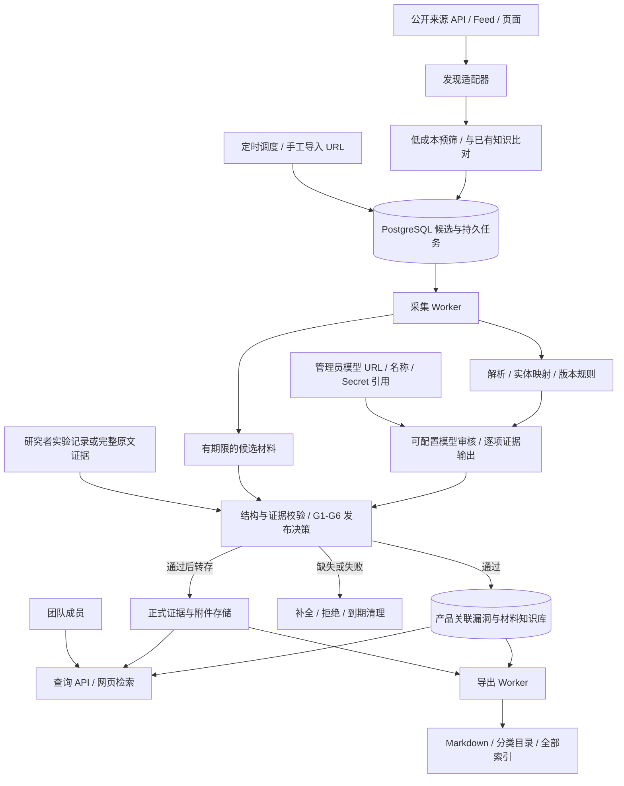

# 漏洞知识库爬虫与存储系统设计

版本：v0.4（产品检索优先、广覆盖收录、可插拔数据源、自动化知识流水线）  
日期：2026-11-01  
适用场景：小团队共享，输入产品名称即可快速查到该产品已收录的可复现漏洞、复现步骤与 PoC/EXP；持续扩大有效覆盖，保留 Markdown 与原始来源。  
第一阶段发现来源：以 GitHub 开源 PoC/EXP 仓库和 Exploit-DB 为主，接入 Sploitus 的可用发现渠道；HackerOne、GHSA、厂商公告等用于补充完整过程、身份和版本证据。来源信息通过门槛与 AI 审核后才进入正式知识库。

> 本文交付系统设计，不包含爬虫实现、真实漏洞数据导入或 PoC/EXP 执行。文中 Demo 产品、编号和版本均为结构示例，不能用于判断真实产品的影响范围。

## 1. 推荐方案与原始想法的调整

本系统定位为**以产品为入口、尽可能广泛收录可复现漏洞的检索知识库**。用户的核心路径是“输入产品名 → 确认产品 → 浏览可复现漏洞 → 获取步骤及 PoC/EXP”。具体漏洞案例是主数据，通用方法是辅助视图；方法提炼、人工复核或实际运行实验都不是普通条目收录的必经步骤。

正式库必须具有实际可取得的 PoC/EXP 或完整复现流程，并明确必要条件、输入、成功判据和安全影响。代码材料可依据完整用法、判定逻辑和可核对的源证据通过材料审核；没有本地实验日志不自动拒收，但必须标注“材料就绪，未独立运行”。只有编号、摘要、“存在 PoC”的失效外链或孤立截图仍不满足入库要求。

“能用于赏金研究”在系统内表示：材料能帮助研究者判断适用场景、复现问题并组织有效证据。是否适用某个当前目标、项目是否接受该问题、是否重复及最终是否支付赏金，必须按具体项目另行判断；历史获奖金额和 CVSS 分数都不能代替可用性审核。

建议采用 **产品目录与别名索引 + 可扩展采集适配器 + 自动补全/AI 评估流水线 + 统一漏洞与材料存储 + 独立检索/导出服务**。默认广覆盖发现、历史回填与持续增量并行；关注产品只提高优先级，不作为其他产品能否收录的门槛。

优化目标按顺序为：产品检索准确且快速；尽可能多收录合格的“产品—漏洞”关系和有效 PoC/EXP；新来源可低成本接入；维持可追溯性与低人工介入。分别统计唯一漏洞数、受影响产品关系数、有效材料数，不能靠复制转载扩大数字。

你提出的“开源/不开源 → 公司 → 产品 → 版本 → 漏洞”适合人工浏览，但不宜直接成为唯一存储模型：

| 原始设计中的情况 | 单纯目录存储的问题 | 建议处理 |
| --- | --- | --- |
| 同一漏洞影响多个产品 | 复制正文和 EXP 后，更新容易不同步 | 每个漏洞有稳定 ID 和一份规范正文，各产品目录生成入口 |
| 同一产品存在多个受影响版本区间 | 为每个版本建目录，会产生大量重复文件 | 存结构化版本规则，目录展示可读范围 |
| HackerOne 报告涉及线上服务 | 经常没有公开的产品版本 | 区分 `unknown` 与 `not_applicable`，保留报告时点和服务资产 |
| 开源与闭源并存的产品 | 公司级别的分类不准确 | 在产品/版本/发行版层面记录开源状态及证据 |
| Log4Shell 等跨产品问题 | 放入“特殊”后，产品检索可能遗漏 | “特殊”作为专题视图，正常产品关系仍然保留 |
| 标题或 CVE 后续发生变化 | 路径、去重键和旧链接会失效 | 使用内部稳定 `KB-UUID`，CVE/GHSA/H1 编号作为外部标识 |
| 只有原始链接，没有抓取快照 | 原站删除后无法追溯 | 同时记录 URL、抓取时间、原始快照和内容哈希 |

核心原则：**广泛发现、自动补齐、分级呈现；满足材料门槛即收录，避免主观“是否热门/有新意”筛选造成漏收。** 一个漏洞可有多个产品关系、来源及材料实现，正文按稳定身份管理。

正式条目分为 `case`（具体漏洞案例）和 `method`（从完整案例提炼的可复用方法）。方法条目也必须有完整的实例过程与证据，不能用抽象检查清单或缺少步骤的案例换个分类绕过门槛。

“公司”需支持维护者、产品厂商、服务运营者等角色。开源项目的维护主体可能是基金会、组织或个人，不能强制要求商业公司。

## 2. 目标、范围与默认假设

### 2.1 必须实现

1. 输入产品名即可查询该产品已收录的可复现漏洞；公司、版本为可选筛选，不要求先选公司或填写版本。
2. 尽可能覆盖已接入来源中有 PoC/EXP 或完整流程的漏洞，自动补齐历史与新增材料；满足门槛后自动入库，关注列表只影响调度。
3. 每条正式案例交付可操作复现包和全部合格材料；复用卡自动生成，非关键补充信息异步完善，保留原文及来源。
4. 区分“材料经审阅完整”“团队独立复现成功”和“对当前目标适用”，不能混为一个已验证标签。
5. 允许没有 CVE、脚本或公开版本的完整案例；禁止只有元数据、失效外链或不完整步骤的正式条目。
6. AI 用于实体映射、材料完整度审核、补全规划、冲突/重复评估和结构化整理；配置模型 URL、名称、Key，自动执行通过或补全流程，人工处理可选。
7. 新来源可用声明式配置或独立插件接入，遵守同一发现/获取/解析契约，不修改搜索、数据库核心或 AI 发布逻辑。
8. 保留幂等采集、断点续采、备份和 Markdown 导出，普通检索与导出仅面向已发布且具备材料的记录。

### 2.2 第一阶段边界

- 采集已公开披露内容；不把“公开项目下出现了一条动态”当成“报告正文已公开”。
- 厂商公告按显式配置的域名和栏目接入，不承诺自动理解任意厂商站点。
- PoC/EXP 来自原站或明确引用的代码材料；完整手工复现流程同样可以入选。不根据摘要自动生成 EXP 充数。
- 采集器不运行下载代码、不测试报告中的地址。第一阶段由研究者手工在本地实验环境验证并上传证据；隔离执行器作为后续独立模块，不要求为了入库重新测试历史线上目标。
- 不做互联网资产扫描；资产清单/SBOM 匹配可在后续扩展。
- 采集、版本比较和索引生成不依赖大模型；默认 AI 模式下，正式发布依赖已配置且通过连通性/输出格式测试的审核模型。模型不可用时只暂停审核，不阻断采集和已发布知识检索。

### 2.3 容量与部署假设

以下是设计和验收基线，不是已测试的性能结论：

- 团队 3～20 人，10 个并发浏览会话。
- 20～100 条仅用于格式与流程验收，不是业务收录上限。上线即开启所接入来源的历史回填，所有符合条件的记录持续收录，不设固定总量配额。
- 容量规划覆盖 10 万条唯一漏洞及对应产品关系/材料；向百万级增长时依据测量拆分检索与 Worker。规模是规划与压测基线，不表示已取得这些数据，也不承诺来源实际存在对应数量。
- 单台 Linux 服务器运行容器；开发环境可以使用 Windows。
- 4 vCPU、8 GB RAM 仅作为开发/试采基线；正式容量根据材料体积、索引、并发及回填吞吐压测确定，不用该基线承诺百万级性能。
- 附件通常比 Markdown 占用更多空间，设置单文件、单记录和总量配额。

### 2.4 正式入库的硬门槛

下面各项全部成立才可发布；未知项进入待补全，失败项拒绝。G1～G5 由确定性材料检查与 AI 语义审阅共同判断，G6 校验完整审核结果；高评分、历史获奖或材料数量不能抵消硬门槛。

| 门槛 | 必须具备的内容 | 不满足的例子 |
| --- | --- | --- |
| G1 来源可追溯 | 已取得的原始材料、稳定父报告 URL、作者/出处与修订或哈希 | 仅转述“网上有 EXP” |
| G2 操作材料完整 | PoC/EXP 路径或完整手工流程至少一条可走通，所需输入均已说明 | 空仓库、伪代码、只有载荷没有用法 |
| G3 场景有边界 | 产品/环境/版本或业务特征，以及身份、权限、配置、依赖等必要条件明确 | 只写“某接口有漏洞”，无法确定适用前提 |
| G4 结果可判定 | 有明确成功信号/判定逻辑及可核对的安全影响依据；原报告结果或代码中的机制可作材料证据，独立运行结果另记 | 仅报错或响应 200 无法支持影响；模型伪造成功日志 |
| G5 能够复用 | 已说明必要参数/依赖、输入和适用限制，能形成可执行的材料使用说明 | 依赖不可替代的失效私有状态；并非要求每条都有新的研究方法 |
| G6 审核完成（默认 AI） | 配置模型逐项审阅 G1～G5，给出可定位证据；系统校验结构、引用、覆盖范围、材料哈希和策略版本后通过，可自动发布 | 只返回“可以利用”或一个分数；引用不存在的文件/行号；仅因模型调用成功而放行 |

G2 有两种合格材料路径：

- **代码路径**：代码已实际取得并可读，依赖/环境、参数含义、执行或手工调用说明、预期结果齐全；可运行不等于已证实存在安全影响，仍须通过 G4。
- **完整过程路径**：环境/账号角色、初始状态、按序操作、必要的请求/输入与响应/状态变化、成功判据及影响链完整；不强制要求有 `.py` 文件。纯视频需整理为带时间定位的步骤及可核对证据后才能通过。

### 2.5 可用性证据与发布状态

三种证据等级可以进入正式库，并全部出现在默认产品结果中；按材料证据强弱标注，用户可另筛“已实际复现”：

| 等级 | 标识 | 发布依据与标签 |
| --- | --- | --- |
| 团队独立复现 | `lab_verified` | 在明确记录的实验环境中按复现包成功完成，留存输入、结果和影响证据；标记“团队已复现” |
| 完整证据审阅 | `evidence_reviewed` | 原报告/代码材料具有完整过程与成功证据，AI 或人工逐项核对并通过引用校验；明确展示审核主体，标记“AI 材料审阅通过，团队未独立复现”或对应人工标签 |
| 可操作材料审阅 | `material_reviewed` | 已取得代码或完整流程，用法、必要条件、判定逻辑及影响依据齐全并通过 AI 审阅；没有独立成功日志，标记“复现材料就绪，未独立运行” |

第二档适用于有完整原始成功证据的公开案例；第三档用于可操作 PoC 没有附执行日志等情况。完整步骤、可判定效果与影响依据仍是底线，只有作者一句“有效”不能替代它们。三档均不表示对用户当前目标已运行成功；缺少独立实验只影响等级，不造成合格材料漏收。

默认 `ai_review.mode=ai`、`auto_publish=true`：合格结果不再等待人工批准。还可选 `hybrid`（AI 审阅后指定条件进入人工复核）或 `manual`；人工复核不是 AI 模式的隐藏必经步骤。完整配置、输出契约和失败语义见第 18 节。AI 静态审阅无权产生 `lab_verified` 或独立实验 `passed`。

状态流转：`discovered → prefiltered → material_ready → in_review → published`；信息不足转 `needs_material`，不合格转 `rejected`。发布后关键材料失效、结论被推翻或复现条件发生实质变化时转 `needs_revalidation`，撤销当前发布资格；修订并通过复核后才能恢复。

### 2.6 主使用流程与辅助研究信息

主流程只需要产品名：识别标准产品及别名 → 展示全部已发布相关漏洞 → 按需要筛版本/类型/材料形式 → 打开具体 PoC/EXP 和步骤。每个结果展示该产品的影响范围、可用材料数量、验证等级、来源和更新时间；不要求先阅读通用方法或配置研究项目。

每条正式知识提供一张“实战复用卡”：适合什么产品或业务场景、需要何种身份/权限/初始状态、如何识别具备同类条件、准备哪些材料、如何判断成功/误报、能证明什么影响、在哪里容易失败，以及哪些信息仍待确认。

项目级的 `scope_match / accepted_class / prerequisites_met / duplicate_risk / checked_at / evidence_url` 独立保存为适用性评估。没有选择项目时全部允许为 `unknown`；公开旧漏洞或原作者获得过赏金，只作为背景，不自动生成“当前可领取赏金”的结论。系统不把历史受影响产品列表当成当前测试任务列表。

## 3. 数据来源与实际可采集范围

### 3.1 来源优先级与接入原则

采用“先获取 PoC/EXP，再补全漏洞知识”的采集顺序。GitHub/Exploit-DB 提供实际材料，聚合站提供发现链路，公告库补全公司、产品、影响版本与修复信息。不同入口的内容统一经过 G1～G6，不因知名来源或平台的 verified 标识而直接发布。

| 优先级 | 来源 | 用途 | 接入方式及边界 |
| --- | --- | --- | --- |
| P0 | GitHub PoC/EXP 种子仓库及自动发现仓库 | 实际代码、README、环境与过程 | 官方 API/固定 commit 文件，历史回填与变更文件同步 |
| P0 | Exploit-DB 官方仓库 | EDB 编号、索引与实际材料 | 官方仓库索引 + 选中文件；网页详情补充来源 |
| P1 | GitHub PoC 索引仓库 | 发现作者原始仓库 | 只作线索，不把 JSON/链接列表当 PoC |
| P1 | Sploitus | 跨站检索与原材料发现 | 先探测公开可用渠道；获取后追踪到原作者/原仓库 |
| P1 | Nuclei Templates / Metasploit Framework | 模板/模块及关联参考 | 可选专门解析器；纯指纹、无影响证明的材料不入选 |
| P2 | HackerOne、技术分析文章 | 完整业务过程及方法 | 仅采集公开材料，按完整流程路径审阅 |
| P2 | GHSA、厂商公告、OSV/NVD | 身份、版本和修复补全 | 发现相关 EXP 时可转入候选，否则只补充现有知识 |

管理员配置种子源、发现策略、允许访问的主机、抓取配额及来源接入能力。默认 `coverage_mode=broad`：不按公司、年份、语言、热门程度或作者星数硬过滤合格材料；关注产品/作者只加权调度。限制到白名单产品/仓库是可选 `focused` 模式，必须显示覆盖范围，不能作为广覆盖默认值。单日配额用于限速与排队，不永久丢弃超额线索。

### 3.2 GitHub 开源 PoC/EXP 仓库（主要来源）

分两类适配：

1. **材料仓库**：仓库内确实存放代码/模板和用法。先读取 README 与文件树，再按材料单元取得必要代码、依赖清单、环境定义及证据；遍历全部符合类型的目录，不只处理关注产品。
2. **索引仓库**：例如 [nomi-sec/PoC-in-GitHub](https://github.com/nomi-sec/PoC-in-GitHub)，用于发现原始材料仓库；索引中的链接、CVE 名称及仓库星数都不能代替原件和审核。索引的许可不自动代表被引用代码的许可。

获取与增量规则：

- 仓库内部身份使用平台 repository ID，来源修订记录 commit SHA；每个材料用 `repository_id + commit_sha + path` 定位，保存 commit 固定链接及文件哈希，不能只存易变的 `main` URL。
- 监控的分支 HEAD 变化后对比文件树；只为相关新增/修改文件建任务。仓库被重命名或转移时更新 URL 映射，保留旧身份与来源。
- GitHub 官方 Trees API 的递归结果可能被截断，检测 `truncated` 后逐子树取回，不能误当成完整仓库。[官方 Trees API](https://docs.github.com/en/rest/git/trees)
- 仓库搜索仅补充新来源发现；结果窗口、鉴权、分页与限流按实际 API 能力处理，记录未覆盖范围，不承诺通过一次搜索覆盖全部 GitHub。[官方 Search API](https://docs.github.com/en/rest/search/search)
- 优先官方 API 或固定修订的文件读取；不默认克隆全仓库、跟随 submodule、拉取 LFS/Release 大文件或运行仓库脚本。确有必要的文件单独入队并受配额控制。
- 同一 CVE 的 fork/复制仓库按原始作者、文件哈希和复现差异关联；保留新增适用条件或修复的价值，不按仓库数重复建知识。
- README 与代码不一致、下载器继续拉取未知载荷、依赖缺失、硬编码外部回连/凭据等信息作为审核证据；未解析的必要代码或二进制使覆盖范围不完整，不能自动批准。

公司/产品提取顺序：维护者公告/包身份与官方仓库 → 原材料明确描述 → 经证据约束的 AI 候选映射。PoC 仓库的作者或 owner 不等于受影响公司的名称；AI 生成的公司、产品、版本关系必须带证据，无法消歧时保留 unknown，禁止为方便搜索而编造归属。

### 3.3 Exploit-DB

以 [Exploit-DB 官方 GitLab 仓库](https://gitlab.com/exploit-database/exploitdb) 和 [SearchSploit 官方说明](https://www.exploit-db.com/searchsploit) 作为接入依据。官方说明列出了仓库和 `files_*.CSV` 索引；部分二进制材料位于单独仓库，因此不能把主仓库当成所有附件都已取得的保证。

适配器读取索引字段及版本信息，识别 EDB-ID、材料路径、标题、作者、日期、平台/类型和可用外部标识，再取得选中的实际文件。CSV 字段按表头解析，不按固定列号硬编码；索引修订与文件哈希共同触发更新。保存 `https://www.exploit-db.com/exploits/<edb-id>`、原始文件路径和固定修订链接。

遍历可取得的完整索引并分批处理所有材料候选，长期保存通过审核的文件；默认不整仓镜像全部二进制。缺少上下文的代码先自动关联用法/公告补全，孤立 shellcode、纯指纹或始终无法界定影响的材料按门槛处理。代码没有附成功截图或运行日志本身不是拒绝理由。SearchSploit 可用于开发交叉核对，不是线上必须启动的进程。

### 3.4 Sploitus 与其他聚合/框架来源

为 [Sploitus](https://sploitus.com/) 设计独立发现适配器，接入顺序为：可公开使用且通过探测的 Feed/导出/API → 页面发现 → 手工导入 URL。**本轮设计核查未能通过检索工具读取其主页与候选 RSS，尚未确认稳定的官方 API/Feed 契约**；因此先标记 `capability_status=unverified`，不假定一个未验证接口可直接使用，也不据此判断站点在部署环境一定不可达。

实现时探测分页、原始来源链接、时间字段、内容覆盖和限流；通过后启用相应模式。若仅可获得标题和聚合页，追踪原始仓库/文章补全；不能以聚合页片段通过门槛。不可用时只停用该源，GitHub 和 Exploit-DB 正常同步，不绕过登录或访问控制。

保留 `discovered_via` 发现链与 `material_origin` 实际代码来源，消除 Sploitus、GitHub、EDB 对同一材料的重复计数。默认最多两跳；在允许域名内按明确引用取文件，不开放式递归。

可选扩展 [Nuclei Templates 官方仓库](https://github.com/projectdiscovery/nuclei-templates) 和 [Metasploit Framework 官方仓库](https://github.com/rapid7/metasploit-framework)。模板/模块专门解析元数据、引用、必要参数、运行时依赖与判定逻辑；不是每个模板都是 EXP，纯产品识别或弱匹配的规则仍会被拒绝。框架版本与材料修订一起保存，不把签名、评级或项目声誉等同于本地独立复现。

### 3.5 HackerOne（完整过程补充来源）

用户提到的 `harkone` 按 HackerOne 理解。

官方 Hacker API 提供 `GET /v1/hackers/hacktivity`，用于分页发现动态；`GET /v1/hackers/reports/{id}` 获取详情。但官方明确说明，`vulnerability_information` 仅在当前 hacker 拥有该报告时返回。因此，不能将详情 API 作为任意公开报告的完整正文转储接口。[官方 API 文档](https://api.hackerone.com/hacker-resources/)

另外，Hacktivity 中可能出现尚未披露的动态；这些记录不能直接当成已公开正文。[官方 Hacktivity 说明](https://docs.hackerone.com/en/articles/8410358-hacktivity)

采用分层策略：

| 层次 | 获取方式 | 产物及限制 |
| --- | --- | --- |
| 发现 | 官方 Hacktivity API，凭据由配置注入 | 来源 ID、标题、披露状态、程序及报告链接 |
| 正文 | 实测可读的官方 API 字段，或允许访问的公开报告页面 | 只归档当前实际可读的公开内容 |
| 动态页面 | 普通 HTTP 获取不足时，独立浏览器适配器渲染公开页面 | 保存正文可见范围与解析结果，不依赖未文档化接口作为主方案 |
| 附件 | 报告中明确提供的附件、图片和引用代码链接 | 每个附件单独记录成功、缺失、过期或无权限 |
| 缺失回退 | 正文不可获取时保留短期补全任务 | 标记 `metadata_only`，不得进入正式库或 Markdown 导出 |

实现前先用少量公开样本做能力探测，确认凭据可用性、正文覆盖率、分页和附件可见性。没有 API 凭据时，允许手动导入公开 URL 或平台提供的公开导出，不把获取 token 当成已经完成的前提。

公开归档有独立准入检查：核对披露状态，并以无特权会话可见内容作为正文与评论的范围依据。持有 API 凭据或能够访问自己的报告，不代表该内容已经公开；仅凭据可见的正文、内部评论和附件不得进入本阶段的公共来源库或团队导出。

优先筛选包含完整过程、关键请求/响应及影响证据的披露报告。是否曾支付赏金、金额高低、点赞数只作背景元数据；不能用来代替材料审核，也不能排除没有公开赏金但复用价值高的完整报告。

### 3.6 GitHub Security Advisories（身份与版本补全）

使用官方全局公告 REST API。该 API 支持按更新时间、生态、CVE 等过滤并分页，公开资源可以匿名访问。系统默认采集 reviewed 类型，显式保存是否撤回；unreviewed 作为可选补充，不能与 reviewed 无差别展示。[官方接口文档](https://docs.github.com/en/rest/security-advisories/global-advisories)

保存 GHSA、关联 CVE、原始版本表达式、修复版本、CWE、评分来源、参考链接和撤回时间。公告列出的参考链接不等于允许无限递归抓取的网站集合。

GHSA 默认作为线索发现和正式条目的版本补充来源。只有进一步取得并审阅 PoC/EXP 或完整复现过程，才能生成正式条目；“reviewed advisory”不等于本系统的“可复现审核通过”。

### 3.7 厂商公告

优先级为：官方结构化 API/公开数据文件 → RSS/Atom → 公告列表与正文 HTML → 必要时页面渲染。

每家厂商有独立适配配置：域名、入口、分页规则、正文选择器、时区、版本字段提取规则、许可信息和解析样本。站点改版后隔离该适配器的错误，不让整个采集任务停止。

优先获取技术分析、官方复现、演示或明确引用的研究原文。只有修复通知或影响版本表的公告，用于补充已入选条目，不独立入库。引用拓展按显式允许域名和最大两跳进行：公告 → 原研究 → 材料文件；保留完整引用链，不进行开放式全网递归。

### 3.8 可选补充：OSV 与 NVD

OSV 适合补充包标识和版本信息，其格式定义了影响包、版本范围、提交范围及外部关系；可借鉴其结构，但本文数据模型不宣称完整兼容 OSV。[OSV 格式规范](https://ossf.github.io/osv-schema/)

OSV API 支持按包及版本或 commit 查询，可作为后续版本核对渠道；无返回结果只表示该查询没有找到记录，不能证明产品不存在漏洞。[OSV 查询接口](https://google.github.io/osv.dev/post-v1-query/)

NVD 的 CPE 信息作为后续候选映射来源。CPE 字典存在某个产品名称，并不表示它受到某漏洞影响；仍需检查漏洞的适用条件。[NVD CPE FAQ](https://nvd.nist.gov/general/faq-sections/cpe-faqs)

OSV/NVD 均为定向查询的补全渠道，不做全量镜像，不因补充到一个新 CVE 而创建未达门槛的正式记录。

### 3.9 数据源配置示例

以下展示来源配置契约。`example-owner/example-poc-repo` 是需要替换的占位仓库，不能直接作为可用源保存；GitHub 凭据与模型凭据独立管理。

```yaml
sources:
  github_materials:
    type: "github_files"
    enabled: true
    repositories: ["example-owner/example-poc-repo"]
    include_globs: ["**/*"]
    exclude_globs: [".git/**", "vendor/**", "node_modules/**"]
    github_token_env: "VULN_KB_GITHUB_TOKEN"
    poll_interval_minutes: 60
  github_discovery:
    type: "github_poc_index"
    enabled: true
    repositories: ["nomi-sec/PoC-in-GitHub"]
    follow_material_links: true
    coverage_mode: "broad"
    max_new_repositories_per_day: 200
    quota_overflow: "defer_with_cursor"
  exploitdb:
    type: "exploitdb_index"
    enabled: true
    repository: "https://gitlab.com/exploit-database/exploitdb"
    fetch_selected_materials_only: true
  sploitus:
    type: "site_discovery"
    base_url: "https://sploitus.com/"
    enabled: false
    require_successful_probe: true
```

文件路径规则用于减少无关下载，材料类型自动识别而非只允许少数扩展名；必要依赖即使落在排除目录，也回到受限获取流程。广覆盖发现的新仓库自动登记到待处理队列，不逐仓库等待人工批准；域名检查和配额仍生效。示例日额度是可调整的初始吞吐参数，未处理引用连同游标持续保留，不能被当作已完成。声明式与代码适配器契约见第 19 节，覆盖推进策略见第 20 节。

## 4. 总体架构



### 4.1 技术建议

| 组件 | 第一阶段建议 | 选择原因 |
| --- | --- | --- |
| 后端 | Python + FastAPI | 采集、清洗、版本处理和网页 API 共用语言 |
| 网页 | 服务端模板 + 少量交互脚本 | 实现统一搜索、公司/产品自动补全、联动筛选、详情与管理页 |
| 数据库 | PostgreSQL，使用受支持稳定版本并固定镜像版本 | 支持多人写入、事务、JSONB、全文索引和持久任务 |
| 文件存储 | 服务器本地持久卷，按 SHA-256 存放不可变对象 | 原始快照与附件去重，后续可换 S3 兼容存储 |
| 入库审核 | 确定性材料校验 + 可配置 AI 审阅 + 发布策略 | AI 默认承担 G6；支持自动发布、可选人工复核与独立实验记录 |
| 模型网关 | 服务端 Provider Adapter + 持久审核作业 | URL/模型/Key 可配置，能力探测、限流、预算及重试统一管理 |
| 采集执行 | 独立 Python Worker，HTTP 客户端 + 可选浏览器渲染 | 长任务不占用网页请求，浏览器故障可隔离 |
| 调度与队列 | PostgreSQL 任务表 + 单独调度进程 | 小团队先避免引入 Redis/Celery 等额外基础设施 |
| 检索 | 关系字段索引 + PostgreSQL 全文搜索 + `pg_trgm` | 优先满足公司、产品、版本查询，兼顾正文关键词 |
| 部署 | Docker Compose，反向代理提供 HTTPS | 单机可部署，数据卷与应用镜像分离 |

FastAPI 的后台任务适合响应后的轻量处理；本设计将采集、重解析和导出放在独立 Worker 中，任务状态写入数据库。[FastAPI 官方说明](https://fastapi.tiangolo.com/tutorial/background-tasks/)

第一阶段不引入向量库、Elasticsearch 或分布式爬虫。若实际查询延迟、数据规模或采集积压超过验收目标，再依据测量扩展。

### 4.2 工作区与正式库的隔离

候选、临时对象和正式知识分表及命名空间管理，不能仅靠前端隐藏。普通查询、附件下载和导出通过统一发布策略访问正式条目；编辑审核使用独立候选接口。

- `discovery_refs`：只保留来源身份、URL、更新时间、预筛信号和去重指纹，不批量长期存全文。
- `candidate_workspace`：为具有材料信号的线索建立工作区；AI 排队、预算暂停和系统故障期间不计算“无进展到期”。自动补全充分尝试后仍无进展的候选默认 14 天转入冷队列，非关键缺项不会让已合格条目退回候选。
- `rejection_tombstones`：默认保留 90 天的最小指纹、拒绝原因和材料版本，避免反复下载；来源或材料哈希变化后可以重新评估。
- 正式对象：仅在通过审核时长期保留快照、代码、复现包和证据；每个发布修订都指向实际对象。

无进展候选转冷后保留来源固定修订、缺项、补全尝试和重新获取定位，7 天内回收无正式引用的临时对象；新材料/解析器/评估策略变化时自动重开，不要求人工重新提交。纯技术错误和预算暂停不能等同于内容不合格。磁盘压力先降低发现/下载并发、暂停新下载并保留待处理引用，不能静默删掉排队中的待审材料。临时全文不进入长期导出，已发布证据继续按历史审计/备份规则保留。

原因使用稳定代码，如 `no_material`、`broken_reference`、`missing_prerequisites`、`missing_steps`、`missing_success_criteria`、`unsubstantiated_impact`、`unrebuildable_dependency`、`exact_duplicate`；区分可补全、明确不合格、暂缓和系统错误。`out_of_focus` 只适用于用户显式选择 focused 模式，不在广覆盖模式中用于跳过产品。相同技术类型或缺少方法新意不构成拒绝原因。

### 4.3 产品检索投影与索引更新

规范数据层保留完整证据与关系，检索侧维护两种可重建投影：`product_search_projection`（标准名、别名、标识、组织和产品修订）及 `product_vulnerability_projection`（product_id + kb_id、有效材料 ID、适用范围、类型、等级与更新时间）。常用过滤建立复合索引，不在每次产品查询时扫描全部原始正文。

产品名首先命中标准目录，随后按 product_id 读取该产品的漏洞投影并批量加载当前页材料，避免逐条远程访问或重复调用模型。outbox 负责新增/变更/降级后的更新，投影检查当前发布修订；索引积压可显示同步时点并按已授权的规范关系回退查询，不能漏掉已发布新记录而不提示。

重新构建投影使用新代次，校验产品关系和材料数后切换，不影响证据存储或适配器。正式发布到可检索延迟作为独立指标验收，初始目标 p95 不超过 60 秒，按实际部署验证。

## 5. 存储目录设计

### 5.1 服务端内部目录

```text
vuln-kb-data/
├── objects/                         # 原始快照和附件的不可变对象
│   └── sha256/ab/<完整哈希>
├── candidate-workspace/            # 有 TTL 的候选快照/代码，与正式对象隔离
├── staging/                         # 未完成下载和导出临时文件
├── exports/
│   ├── <generation-id>/             # 一次完整、不可变的导出成果
│   │   └── knowledge/              # 见下节
│   └── current.json                 # 当前发布代次的清单指针
└── backups/                         # 本地暂存；另有异机副本
```

数据库使用独立持久卷。浏览器用户通过网页访问，不直接共享挂载数据库文件或在服务器目录中并发编辑。

`objects` 不公开为静态目录；网页下载必须通过附件 ID 查询和鉴权。对象哈希用于内容去重，来源归属保存在多对多关系中，不能因文件字节相同而丢掉不同来源。

### 5.2 可独立阅读的 Markdown 导出目录

```text
knowledge/
├── index.md                         # 全部索引：仅当前审核通过的正式知识
├── index.json                       # 机器可读的全部索引
├── manifest.json                    # schema、代次、文件路径与哈希
├── records/
│   └── KB-<uuid>/                   # 规范漏洞目录，真实环境使用 UUID
│       ├── report.md               # 统一摘要、影响范围、修复、来源
│       ├── reproduce.md            # 环境、输入、逐步过程、预期结果与排错
│       ├── reproductions/
│       │   └── <material-id>.md     # 每种 PoC/EXP 实现的用法与适用产品/版本
│       ├── field-guide.md          # 场景识别、迁移参数、成功判据与影响证明
│       ├── validation.json         # 审核等级、证据、材料哈希和适用边界
│       ├── record.json             # 可导回的规范数据及证据关系
│       ├── notes.md                # 人工笔记的导出副本
│       ├── sources/
│       │   ├── hackerone-<id>.md    # 对应来源正文及完整度
│       │   └── vendor-<id>.md
│       ├── evidence/               # 原始成功证据或团队实验结果，保留来源
│       ├── poc/
│       │   ├── poc-01.py           # 仅存在原站确实提供的材料
│       │   └── poc-01.py.source.json
│       ├── exp/
│       │   ├── exp-01.txt          # 类型不确定时不假装是可运行脚本
│       │   └── exp-01.txt.source.json
│       └── attachments/
│           ├── image-01.png
│           └── image-01.png.source.json
├── 开源/
│   └── DemoOrg/
│       └── DemoServer/
│           └── range-<规则短哈希>/
│               ├── index.md        # 展示原文版本范围和适用条件
│               └── CWE-22_KB-<uuid>.md
├── 不开源/
│   └── DemoCorp/
│       └── DemoCloud/
│           └── not-applicable/
│               └── CWE-79_KB-<uuid>.md
├── 待确认/
│   └── unknown-vendor/
│       └── unknown-product/
│           └── unknown/
│               └── unclassified_KB-<uuid>.md
├── 特殊/
│   ├── Log4Shell/
│   │   └── index.md                # 专题简介和规范漏洞链接
│   └── 待确认术语/
│       └── index.md
├── 方法/
│   └── <功能场景>/
│       └── <漏洞类型>/index.md      # 关联同样经过审核的规范方法条目
└── indexes/
    ├── companies/index.md
    ├── products/index.md
    ├── cwe/index.md
    └── years/index.md
```

分类目录的最内层 Markdown 是轻量入口，包含漏洞 ID、标题、该产品的版本规则、原始来源链接，以及到规范正文/PoC/EXP 的相对链接。附件实际保存在 `records/`，不为每个公司或版本重复复制。

`reproduce.md` 是每条正式记录的复现材料总入口，按产品/版本关联各实现用法；`field-guide.md` 由 AI/模板生成辅助信息，非关键字段可标 unknown，不因未提炼出新方法或通用排错经验而阻断入库。`poc/exp` 仅在有原件时生成。没有脚本但过程完整可以收录，只有脚本却没有必要条件或成功判据不能收录。“待确认”仅表示已合格记录的非关键归属属性待补充，不混入未审核材料。

同一个漏洞可以同时出现在“开源”和“特殊”，也可以关联多个产品。“特殊”不是排他性分类。`php2shell` 暂保留为待确认术语，待确认具体漏洞或漏洞家族后再建立正式专题，避免误关联。

### 5.3 路径与命名规则

- 开源状态使用 `open_source / closed_source / mixed / unknown`；混合状态按具体组件或发行版拆分，不能拆分时进入“待确认”。
- 每层显示名称与内部 ID 分离；同名公司/产品加稳定 ID 后缀区分。
- 单个明确版本使用 `v-1.2.3/`；范围使用 `range-<hash>/`，在其 `index.md` 中显示 `>=1.0.0, <1.4.2` 等原始表达式。
- 不直接把 `< > : " / \\ | ? *` 等字符放进目录；处理 Windows 保留名、尾随空格/点、大小写冲突、Unicode 规范化和路径长度。
- 单个路径段默认不超过 48 字符，导出相对路径预算不超过 180 字符；超长时截断并附稳定哈希。完整名称保留在元数据中。
- 分类入口允许随元数据变化重建；内部 ID 和网页地址 `/knowledge/{kb_id}` 保持稳定，降级后该地址显示当前状态而不继续分发材料。
- 使用普通相对链接，不依赖 Windows 与 Linux 行为不同的符号链接。
- Markdown 默认 UTF-8、LF；原始附件保留原字节和原始文件名元数据。

## 6. 数据模型

### 6.1 实体与主要关系

| 实体/表 | 关键字段 | 作用 |
| --- | --- | --- |
| `organizations` | id、name、kind | 公司、基金会、维护组织或个人主体 |
| `products` | id、name、kind、repository、openness | 产品、组件、库、服务及其身份 |
| `product_identifiers` / `product_alias_assertions` | product_id、namespace、value、evidence、status、revision | 包、仓库、厂商标识及中英文/历史别名；AI 映射必须有证据 |
| `product_relations` | parent_id、child_id、type、conditions、evidence | 产品家族/发行版/组件关系，不能自动推导所有版本都受影响 |
| `organization_products` | organization_id、product_id、role、evidence | 区分厂商、维护者、运营者等角色 |
| `entity_aliases` | entity_type、entity_id、alias、namespace、status | 公司简称、历史名、产品别名和包名映射 |
| `knowledge_entries` | kb_id、entry_type、title、summary、publication_state、revision | 具体案例或复用方法，只有 published 对普通读者可见 |
| `discovery_refs` / `candidates` | source_ref、fingerprint、signals、state、expires_at | 低成本发现及短期候选，和正式知识分开 |
| `admission_reviews` | candidate_id、G1-G6_results、reviewer_kind、reviewer_ref、material_revision、policy_version、decision | AI/人工审核及最终决定，不能由总分绕过 |
| `source_configs` / `source_cursors` | type、endpoint_or_repo、path_filters、priority、capabilities、cursor、secret_ref | GitHub/EDB/Sploitus 等来源的配置和增量能力 |
| `adapter_registry` / `adapter_releases` | adapter_id、contract_version、parser_version、manifest、capability_report | 新来源插件注册、版本、能力测试及回滚信息 |
| `coverage_partitions` / `coverage_events` | source_id、partition_key、cursor、watermark、state、counts、last_progress_at | 按年份/目录/范围衡量回填覆盖和积压，区分已处理、暂缓、失败 |
| `enrichment_jobs` / `deferred_refs` | target_id、missing_fields、attempt_history、next_run_at、reopen_trigger | 自动补全与冷队列，不因预算暂停或非关键缺项永久漏收 |
| `ai_providers` / `ai_models` | provider_id、base_url、api_style、secret_ref、model_name、capabilities、config_revision | 模型连接与配置；不保存可直接返回浏览器的明文 Key |
| `ai_review_jobs` / `ai_review_attempts` | input_hash、model_config_revision、rubric_version、status、token_usage、output_ref、evidence_validation | 审核队列、不可变尝试、用量、输出及证据验证 |
| `material_variants` | kb_id、material_id、format、artifact_refs、package_id、review_state、source_revision | 同一漏洞的多个独立 PoC/EXP/完整过程实现，不因同一 CVE 丢掉不同实现 |
| `reproduction_packages` | kb_id、material_id、environment、prerequisites、inputs、steps、success_criteria、limitations、hash | 每个材料实现的可用说明；公共字段可以复用但不混写不同实现参数 |
| `product_material_links` | impact_id、material_id、applicability、version_conditions、evidence | 该 PoC 是否适用于本产品/版本，防止用其他产品的 EXP 误充本产品可复现 |
| `validation_runs` | kb_id、package_hash、environment_hash、executor、result、evidence_refs、run_at | 手工实验结果，成功必须有证据，失败记录不能被覆盖 |
| `usability_assessments` | kb_id、evidence_grade、portability、cost、freshness、checked_at | 证据等级与使用条件，不输出虚构收益概率 |
| `field_guides` | kb_id、scenario、feature_signals、parameter_mapping、false_positives、impact_evidence | 每条知识的实战复用卡 |
| `program_assessments` | kb_id、program_ref、scope_match、accepted_class、duplicate_risk、checked_at、evidence | 针对具体项目的独立适用性评估 |
| `rejection_tombstones` | source_ref、fingerprint、reason_code、expires_at | 有期限的拒绝指纹，不长期保存无价值正文 |
| `external_ids` | namespace、value、kb_id、relation、status | CVE/GHSA 等标识与审核后的归属 |
| `source_documents` | source、source_id、canonical_url、visibility、content_status | 来源文档身份，同一文档可涉及多个漏洞 |
| `source_revisions` | document_id、fetched_at、upstream_modified_at、object_hash、parser_version | 来源历史快照 |
| `entry_sources` | kb_id、document_id、relation | 多个来源关联同一知识，或一篇公告关联多个案例/方法 |
| `impacts` | kb_id、product_id、edition、platform、conditions | 一个漏洞对一个产品/发行版的适用信息 |
| `method_applicability` | kb_id、scenario、feature_constraints、required_roles、product_id | 方法适用的功能特征与前提；product_id 可空，不伪造产品漏洞关系 |
| `version_rules` | impact_id、scheme、raw、ranges、explicit_versions、status | 精确版本、区间、分支和版本证据 |
| `assertions` | target、field、value、source_revision_id、locator、confidence、review_state | 每个关键结论的来源及冲突保留 |
| `artifacts` | id、object_hash、media_type、size、classification | PoC、EXP、截图等材料的内容身份 |
| `artifact_origins` | artifact_id、source_revision_id、original_url、retrieved_at、license | 一个文件的一个或多个来源 |
| `artifact_links` | artifact_id、kb_id、impact_id、evidence_status | 材料与漏洞及适用产品的关系 |
| `topics` / `topic_links` | topic_id、name、kb_id、relation | 跨产品专题或漏洞家族 |
| `record_relations` | from_kb、to_kb、type、evidence | related、duplicate_candidate、upstream、derived、extracted_method 等关系 |
| `manual_notes` / `overrides` | kb_id、field、value、reason、author、revision | 人工笔记和已确认的字段覆盖 |
| `crawl_jobs` / `source_checkpoints` | job_key、state、lease_until、attempts、cursor | 持久任务和增量水位 |
| `publication_outbox` / `export_generations` | revision、state、manifest_hash、published_at | 数据变更后可靠触发导出 |
| `users` / `audit_events` | role、actor、action、object、before、after | 团队访问及修改追踪 |

常用索引覆盖公司/产品标准名与别名、外部编号、影响对象、来源更新时间、任务状态和可执行时间。范围字段可保留 JSONB 原始结构，但用于过滤的身份和状态不只塞进 JSONB。

### 6.2 身份与归属规则

- `KB-UUID` 创建后不随 CVE 补充、标题变化或产品归属变化而改变。
- H1 报告编号优先是来源文档身份，不自动视为跨来源漏洞别名。
- 没有 CVE 的报告也可以形成独立漏洞条目。
- 产品身份优先采用生态+包名、仓库 URL、厂商产品标识等明确证据；PURL/CPE 为可选标识，不能凭名称生成可信映射。
- 仓库所有者、漏洞提交者和受影响产品厂商不是同一个概念。
- 服务运营者发生漏洞，不代表其使用的所有开源组件都存在同一漏洞。
- 产品改名、组织并购通过别名和带时间的归属关系处理，不重新生成所有 KB ID。

### 6.3 状态必须分开记录

| 维度 | 示例值 | 含义 |
| --- | --- | --- |
| 来源可见性 | public / restricted / unavailable | 当前来源访问范围 |
| 正文完整度 | metadata_only / partial / complete | 相对当前可见正文的归档情况，不承诺获取隐藏评论 |
| 来源业务状态 | resolved / duplicate / informative 等原始值 | 原平台的判断，与本地审核分开 |
| 本地审核状态 | pending / reviewed / conflict | 本地数据质量判断 |
| 发布资格 | candidate / published / needs_revalidation / rejected | 由门槛与审核控制，独立于漏洞事实和来源状态 |
| 可用性证据等级 | material_reviewed / evidence_reviewed / lab_verified / unassessed | 材料就绪、原始成功证据、独立实验分开；前三档可发布，unassessed 不可发布 |
| 记录状态 | active / withdrawn / merged | 规范条目是否撤回或被合并 |
| 版本信息状态 | known / unknown / not_applicable / conflict | 是否能作版本判断 |
| 附件状态 | referenced / downloaded / missing / denied / failed | 单个附件的获取情况 |
| 独立实验结果 | not_run / passed / failed / inconclusive | 是否实际执行过以及结果；证据审阅不能改为 passed |

评分保存 CVSS 版本、向量、分数和来源。不同来源评分冲突时并列展示，不静默取最高分。

`publication_state` 的发布条件在数据库写入服务、查询服务和导出器共同校验：G1～G6 全通过、复现包完整、至少一种合格材料路径、证据等级有效、关键材料哈希与审核修订一致。`entry_type=method` 同样执行该条件，不豁免。版本未知不是自动拒绝原因，但若缺失导致无法判断实验/迁移条件，就不能通过 G3。

`method` 必须有明确场景和完整实例证据，产品/公司可不适用，走“方法”目录及场景索引，不为凑目录而构造 unknown-product 的漏洞。`metadata_only` 可以描述正式知识的一份补充公告，但不能成为该知识唯一的操作材料；正文完整度与复现可用性独立评估。

正式案例发布要求至少有一个合格材料实现；不要求同漏洞所有来源/所有 EXP 都审核完。新实现单独审核，通过后追加，失败不影响已有有效实现。产品结果依据 `impact + product_material_links` 关联：同一漏洞在 A 产品有 EXP，不自动意味着该 EXP 可直接用于 B 产品。

证据等级保存在材料实现及其适用环境上。结果页聚合等级只能从当前产品/版本匹配的实现中选取，不能拿其他产品或版本的已复现记录给本次结果标记“已验证”。

## 7. 版本匹配设计

版本检索是本系统的核心能力，不能通过目录名或字符串大小比较完成。

### 7.1 规则表示

每条规则保存：产品和生态、发行版/分支、原文表达式、比较方案、区间端点及开闭、显式影响/不影响版本、引入/修复提交、平台及配置条件、证据和规则解析版本。

- npm、PyPI、Maven、Debian 等使用各自版本语义；不能把全部生态都交给 SemVer。
- 对暂未实现的比较方案，保留原文，返回“未知”，不能降级为字符串比较。
- 多条区间保留独立分支；`fixed` 只结束所属区间，不推导所有更高版本永久安全。
- 预发布版本、厂商构建号、发行版回移补丁必须保留。上游版本看似受影响，不等于已回移补丁的发行版包仍受影响。
- CPE 复杂条件树或 commit 范围不能完整计算时，保留原始条件并返回“未知/条件相关”。

### 7.2 查询顺序

1. 根据公司角色、产品标准 ID、生态或包名确定候选产品。
2. 在当前正式发布的知识中查询该产品的具体案例及明确上游关联；完整方法按场景另行关联，不当成该产品已确认受影响的漏洞。
3. 选择匹配发行版、分支、平台的规则，调用对应比较器判断版本。
4. 判断必要配置条件；未提供条件时单独标记“条件待确认”。
5. 返回规则、原文证据、结论、数据更新时间和本次判定所用比较器版本。

结论包括 `affected`（受影响）、`not_affected`（依据现有规则不在影响范围）、`unknown`（信息不足）、`conflict`（证据冲突）。另有 `conditional` 标志表示尚需核对运行条件。

**没有查询结果不等于产品安全；`unknown` 也不能被默认过滤成“不受影响”。** 网页默认分别显示正式案例的明确命中和环境待确认项，方法建议使用独立分组；未过入库门槛的候选不能混入结果。

### 7.3 示例

假设 DemoServer 的证据支持 `[1.0.0, 1.4.2)` 和 `[2.0.0, 2.1.3)`：

| 输入 | 结果 | 解释 |
| --- | --- | --- |
| 1.4.1 | affected | 命中第一段 |
| 1.4.2 | not_affected | 按该已知规则不在第一段内 |
| 2.1.2 | affected | 命中第二段 |
| 未提供版本 | unknown | 仍显示产品相关漏洞，等待版本信息 |
| 1.4.1-vendor7 | unknown | 未知厂商版本语义或回移补丁情况 |

SaaS 服务如果不公开版本，可用 `not_applicable`，同时保存报告提交/披露/修复时点；如果本应有版本但来源没写，使用 `unknown`。历史报告不能被当成该服务当前仍存在漏洞的证据。

版本命中只表示规则适用，不表示 PoC 已在本次目标上运行成功，也不表示该目标项目接受该类报告。检索结果同时显示复现包使用的版本/环境；不能把在一个版本上的成功实验扩展为所有版本都已验证。

## 8. 采集流程与任务可靠性

### 8.1 标准流水线

```text
仓库/EDB/聚合源定向发现 → 轻量预筛 → 记录跳过指纹
→ 合格候选持久入队 → 获取固定修订材料 → 提取身份/版本/证据
→ 生成复现包与复用卡草稿 → 确定性材料检查 → 配置模型逐项审核
→ 校验 AI 输出结构/证据引用/材料覆盖 → 计算 G1-G6 及发布资格
→ AI 模式通过后自动提交正式修订；可选追加手工实验或人工复核
→ 更新正式检索数据 → 生成并发布 Markdown
缺项 → 有期限的补全任务；失败/到期 → 拒绝并清理临时对象
```

材料不完整时只推进候选任务，不创建可检索的正式知识。PoC 下载失败但存在另一条完整的手工流程，可以按手工流程路径审核；如果缺失的是唯一必要材料，则必须等待补全。解析失败的快照仅在工作区 TTL 内保留供重解析。

预筛采用多信号召回，包含代码、框架模块、模板、完整流程、环境/参数与判定逻辑，不能依赖标题是否出现 `PoC`。广覆盖模式对已接入目录中的合格候选持续处理，关注产品只提高优先级。只有摘要的公告仍可作为自动寻找复现材料的线索，不直接正式入库。

缺项处理先进入自动补全：根据 CVE/EDB/包身份/代码引用找到相关原文、依赖及另一份材料 → 重新评估 → 通过则发布。公司介绍、中文摘要、评分、非必要的排错提示等缺失不会阻塞已有可操作材料；关键前提缺失才阻塞对应实现。来源保留的版本/用法不能通过模型编造补齐。

### 8.2 来源适配器契约

```text
manifest()                         # 稳定 adapter_id、契约版本、所需配置与 Secret
probe(config)                      # 连通性、分页/回填/增量/正文与附件能力
discover(partition, cursor, budget) # 返回 SourceRef 页、下一游标与是否真正完成
fetch(source_ref, transport)        # 返回原始快照、状态与固定修订定位
parse(snapshot, parser_version)     # 标准 SourceDocument、MaterialRef、ClaimDraft
normalize_error(error)             # 统一重试/鉴权/限流/解析/永久缺失等错误
```

网络、限速、重试、对象存储、Schema 校验、AI 审核和任务状态属于公共层，适配器不直接发布知识或写检索库。声明式映射可覆盖常规 Feed/JSON/HTML/仓库，复杂站点单独实现插件；完整开发与兼容性契约见第 19 节。

### 8.3 增量策略

- 首次为每个已启用来源枚举可访问的历史分区，按年份/目录/分页分批回填所有材料候选；不限定少数关注产品，也不把全量公告全文直接发布到知识库。
- 后续优先同步新线索及正式条目的材料变化；只有发布时间时，结合已发布记录回访与分批对账，不对所有拒绝候选轮询全文。
- 查询窗口采用 `(上次水位 - 重叠窗口, 本轮固定上界]`，初始重叠 72 小时，并通过幂等写入消除重复。
- 有游标使用官方游标；动态页码分页存在插入/排序漂移时，通过重叠抓取和周期性对账降低漏采风险。
- HackerOne 可按最近公开活动排序发现变化，但不能据此承诺覆盖所有静默修改；仍需历史回访。
- 最近 30 天正式条目每日检查来源/材料变更；其余正式条目分批轮巡，默认每月对账。证据审阅与实验复核另设时间，不把一次 URL 回访当成重新复现。
- 支持 ETag/Last-Modified 时发送条件请求；收到 304 仅更新检查时间。
- 一个发现页的线索必须全部持久记录处置结果（跳过指纹或候选作业）后才能推进水位。详情失败保留有限重试和到期信息，不能随页码推进而丢失。
- 中止、超时或触达 API 搜索窗口的回填显示剩余分区和覆盖限制；按可用日期/目录分拆，仍无法完整获取的标记 partial，不能把当前条数当成来源全量。
- 回填、增量、补全和维护任务分队列公平调度，保留最低吞吐份额，避免关注产品或热门最新漏洞长期挤占冷门产品/旧版本的任务；具体策略见第 20 节。

### 8.4 限速与重试

- 每个主机独立限速；起始策略为 1 个并发、请求间隔至少 2 秒，服从来源更严格的实际要求。
- 429 优先遵守 `Retry-After`；否则指数退避并加入抖动。
- 网络错误、超时和 5xx 可重试；401/403 转入凭据或访问问题队列，避免反复无效请求。
- 404/410 对正式条目标记来源不可用；若本地材料仍完整，不取消可用资格。候选则进入补全或拒绝，不能因已抓到标题而入库。
- 默认每个作业最多 5 次自动尝试，之后进入 `dead_letter`；管理员可修复配置后重试。
- 初始连接超时 10 秒、读取超时 60 秒；附件使用流式下载和大小限制，可按来源调整。

### 8.5 幂等、租约与事务边界

- 来源身份唯一键：`(source, source_id)`；GitHub 保存 repo ID/commit/path，EDB 保存 EDB-ID/索引修订；无原站 ID 时使用保守规范化后的 URL。
- 来源修订按文档 ID 与正文哈希去重；任务按作业类型、来源身份及目标修订构建唯一键。
- Worker 通过行锁领取任务并设置租约，领取后立即提交短事务，再执行网络操作。
- 使用 `FOR UPDATE SKIP LOCKED` 可支持多个消费者领取队列任务；它只用于任务领取，不用于需要一致结果的业务检索。[PostgreSQL 官方说明](https://www.postgresql.org/docs/current/sql-select.html)
- Worker 心跳续租，崩溃后超时任务可重新领取；完成提交校验租约令牌，防止旧 Worker 覆盖新结果。
- 实体与版本写入使用数据库唯一约束和事务，处理至少一次执行导致的重复。
- 候选审核通过后，先固化正式材料对象，再在一个事务中提交发布修订、材料引用和 `publication_outbox`；不允许只有数据库标签通过但关键文件尚未持久化。
- 未通过审核的孤立对象按 TTL 回收；正式发布或撤销发布均可靠触发索引与导出更新，失败可独立补偿。
- 定时调度使用数据库锁保证只有一个活跃实例；网页多进程启动不能重复触发整轮采集。

## 9. 去重、关联与人工纠错

### 9.1 三层去重

1. **来源文档去重**：同一 H1 报告或同一公告重复抓取，归于一个来源身份。
2. **内容对象去重**：相同字节的快照/附件使用同一哈希对象，但保留所有来源关系。
3. **漏洞实体归并**：仅在有明确别名映射或经过确认的证据时归并为一个 KB 条目。

强证据包括官方明确给出的同义漏洞编号及针对同一根因的确认说明。单纯出现相同 CVE 文本、相同 CWE、相同标题关键词或相似正文均不足以自动合并。

一篇公告可能列出多个 CVE，应拆出多个漏洞或建立多对多关系，不能将全部编号当成同一漏洞别名。两个站点因相同上游漏洞受影响，也需要区分“上游缺陷”和“具体部署中的报告”。

### 9.2 冲突与合并

- 不同来源关于版本、严重性、修复状态的说法保留为不同 assertion。
- 优先展示经审核且适用上下文一致的官方/维护者证据；不能简单按“最后采到的值”覆盖。
- 精确来源身份、文件哈希和有证据的同一缺陷标识关系可自动关联；AI 评估复杂重复候选，满足版本化规则后进行可撤销的关联或归并，保留旧 ID、原记录及回滚事件。歧义则暂时分别收录并标记 related，不要求人工先裁决才能入库；物理删除和不可逆改写不由 AI 执行。
- 被合并的 ID 保留跳转到规范 ID；支持拆分和撤销合并的审计历史。
- CVE 撤回、公告撤回、原站删除和本地误归并是不同事件，分别处理。

### 9.3 同类知识的增量价值

以事实身份去重，不以“同类漏洞太多”或“方法没有新意”拒收不同漏洞。相同 CWE/技术模式在不同产品、不同缺陷或不同边界形成的合格案例全部收录；同一漏洞的不同语言实现、版本支持、框架模块、依赖与操作方式保存为多个材料实现，产品详情统一展示。

完全相同字节及重复转载复用对象和来源关系；实质不同的实现保留各自说明及适用范围。通用方法自动提炼可以异步进行，既不阻塞具体案例发布，也不把多个独立漏洞压缩成一个方法条目造成产品覆盖丢失。

方法从已达门槛的完整案例提炼，保留与案例的关系、可迁移条件和不适用边界。没有证据支撑的“可能还能这样绕过”放入人工研究笔记，不进入已审核方法正文。降低重复并不意味着把不同安全边界或不同业务根因强行合并。

### 9.4 人工编辑的保存方式

网页编辑结构化覆盖项和笔记，数据库保存作者、原因和版本。下一次采集更新来源层，不覆盖人工层；人工结论引用的原始证据变化时，触发“需要复核”。

Markdown 是生成成果，直接修改导出文件不会自动反写数据库。需要离线编辑时，通过显式导入校验基础 revision，冲突则交由人工处理，避免采集与多人文件修改互相覆盖。

### 9.5 失效与复核

- 审核记录绑定来源修订、代码哈希、复现包哈希和关键实验环境，修改关键参数、依赖或成功判据后必须重审；格式整理不需要重新跑实验。
- 本地关键代码/证据丢失、原结论被有效反证或确认同条件复现失败时，对应材料转 needs_revalidation 并停止分发；只有漏洞的全部适用材料都不再合格时，才撤销该产品关联的可复现资格。旧原因与历史保留，新增实现待审不会撤销其他有效实现。
- 某目标修复或某版本不再受影响，只更新影响范围/项目适用性，不自动废弃仍有完整证据和迁移价值的历史案例。
- 原链接失效但本地复现包与证据完整，不等于知识失效；依赖不可重建且没有完整可核对过程时，不能继续宣称可用。
- 发布的代码路径默认 90 天检查依赖与材料可取得性，完整过程路径默认 180 天复核边界；只检查文件不是一次独立复现，分别记录 `material_checked_at` 与 `last_verified_at`。
- 已下载的历史导出不可远程撤回；每份导出写明生成时间和审核时点，在线稳定链接始终显示当前发布状态。新版导出移除降级条目，历史审计只对编辑开放。

## 10. Markdown、PoC、EXP 与来源规范

### 10.1 漏洞正文结构

每个 `report.md` 包含：YAML front matter、该条知识能解决什么研究问题、适用公司/产品/版本或业务场景、前置条件、复现包、复用卡、证据等级、复现限制、修复信息、字段冲突及原始来源。阅读者进入详情后应先看到“如何用、适合哪里、验证到哪一步”，再展开原始长报告。

示例 front matter：

```yaml
---
schema_version: "1.3"
kb_id: "KB-DEMO-0001"
entry_type: "case"
title: "DemoServer 路径穿越问题（示例）"
external_ids: []
cwe: ["CWE-22"]
record_state: "active"
publication_state: "published"
review_state: "reviewed"
evidence_grade: "evidence_reviewed"
independent_execution: "not_run"
admission:
  gates: {G1: pass, G2: pass, G3: pass, G4: pass, G5: pass, G6: pass}
  reviewer_kind: "ai"
  reviewer_ref: "provider-demo/model-demo"
  review_job_id: "review-demo-001"
  rubric_version: "admission-1.2"
  material_revision: 1
  reviewed_at: "2026-11-01T00:00:00Z"
reproduction:
  pathway: "manual_procedure"
  package_ref: "reproduce.md"
  package_hash: "sha256:<实际复现包哈希>"
  evidence_refs: ["evidence/demo-result.txt"]
  guide_ref: "field-guide.md"
  last_verified_at: null
revision: 1
products:
  - product_id: "product-demo-server"
    organization: "DemoOrg"
    name: "DemoServer"
    openness: "open_source"
    version_status: "known"
    version_scheme: "semver"
    affected_raw: ">=1.0.0, <1.4.2"
    conditions: []
sources:
  - document_id: "vendor-demo-001"
    original_url: "https://example.com/security/demo-001"
    source_modified_at: null
    fetched_at: "2026-11-01T00:00:00Z"
    content_status: "complete"
    snapshot_ref: "sha256:<实际内容哈希>"
artifacts:
  poc: []
  exp: []
---
```

`KB-DEMO-0001` 仅为文档示例，生产环境生成 `KB-UUID`。front matter 用于阅读和常用筛选；完整的多产品、多区间及字段证据写入 `record.json`，两者必须来自同一规范修订。

示例选择“完整手工过程”路径，所以允许 `poc/exp` 为空，但引用的复现包和成功证据必须实际存在并可通过审核。真实系统不能仅凭这份 front matter 中写了 `pass` 就批准发布，必须核对数据库审核记录、文件及哈希。

时间入库存 UTC，网页按 Asia/Shanghai 展示；原始日期字符串和原时区另行保留。来源没有修改时间时使用 null，不能拿抓取时间冒充来源修改时间。

### 10.2 每个最内层文件如何记录 source

- Markdown：front matter 和正文末尾“原始来源”都列出 URL。
- 原始脚本：保留原字节，不为增加注释而修改原件；相邻 `<文件名>.source.json` 必须记录原始链接。
- 二进制/图片：同样使用 sidecar，正文附件表提供可读来源链接。
- 从正文抽取的代码块：记录父报告 URL、来源修订、块序号/位置、原片段哈希和抽取器版本，标记 `extracted`。
- 整理改写的衍生代码与原件分开保存，记录 `derived_from` 和修改说明，不覆盖原件。
- 同一附件有多个来源时，sidecar 保存 `origins[]`，不能只留下最后一次发现的 URL。

sidecar 最低字段：`artifact_id`、`classification`、`sha256`、`size`、`media_type`、`origins[]`、`retrieved_at`、`license_status`、`derivation`、`verification_state`。每个 origin 至少有稳定父报告 URL，能公开保存时再附直接下载 URL。临时签名参数和凭据不进入导出文件，必要的原始请求信息只保存在受限服务端元数据中。

### 10.3 附件类型判定

| 类型 | 判定标准 |
| --- | --- |
| PoC | 来源提供用于说明或验证问题的代码/请求/材料 |
| EXP | 来源明确描述为利用程序，且本地分类有对应证据 |
| 未分类代码 | 仅根据扩展名或代码块无法判断用途 |
| 普通附件 | 截图、日志、修复补丁、说明文档等 |

PoC/EXP 分类与“已验证可用”分开。`description_only` 或 `referenced` 只表示材料状态，不提供入库资格：若另有完整手工流程且全部门槛通过，可以发布；否则只停留在候选工作区。不能创建一个空脚本让网页显示“已有 EXP”。

Markdown 优先保留原始 Markdown；HTML 转换为 Markdown 时保留代码、列表、表格和图片对应关系。远程图片成功落盘后改为相对路径，失败则保留原链接及缺失状态。

原始原文、清洗结果、AI 整理与人工笔记分开保存。AI 除摘要、翻译和候选提取外，默认承担 G6 材料审核与草稿整理；所有结论标记模型、策略版本、时间和证据。模型不能凭推断补出版本、CVE、成功实验或缺失的 EXP，整理后的复现步骤也要逐项引用原件。

### 10.4 复现包必备内容

`reproduce.md` 必须在不依赖临时外链、作者私有账号或未说明状态的情况下，交代以下内容。必要外部依赖可以显式列出，但缺失的不可替代依赖会阻断发布。

| 区块 | 内容 |
| --- | --- |
| 适用边界 | 案例/方法类型，产品版本或业务功能特征，原案例发生与修复时点 |
| 环境与准备 | 系统、依赖及版本、配置、账号角色、初始数据和所需权限；不适用项明确标注 |
| 材料清单 | 原始代码/请求/过程、可取得的位置、文件哈希、参数说明 |
| 操作过程 | 编号步骤、每步输入、必要状态变化、下一步前提；证据位置可定位 |
| 成功判据 | 可观察的结果、正常对照、如何排除误报与证明安全影响 |
| 失败排查 | 哪些依赖/条件会导致失败，哪些版本或业务约束不适用 |
| 验证记录 | 原作者证据与团队实验分开，说明执行人、时间、环境、结果及限制 |
| 清理与恢复 | 实验产生的数据或状态如何还原；纯证据审阅则标注未执行 |

“步骤完整”按能否从准备阶段走到可判定结果审阅，不按字数、步骤数量或是否出现攻击关键词计分。涉及多角色时明确角色切换；只在作者原站保留的截图、不含操作输入的录像或缺少关键中间状态，都不能自动视为完整。

### 10.5 自动生成的实战复用卡

`field-guide.md` 回答：在什么功能/组件中值得参考，必要权限和业务前提是什么，哪些参数及标识需要替换，哪些条件不能照搬，如何判断观察结果确实体现安全影响，以及复现成本和常见失败点。

卡片复用复现包中已有的必要条件，其他字段允许标注 unknown 并异步补齐；卡片是否富有经验总结不参与具体案例的收录判断。材料已有完整用法时，可以模板化立即生成，不等待额外模型润色或人工撰写。

完整业务案例即使原服务已修复，也可提供方法价值，但必须明确“历史成功证据”和“可迁移假设”的边界；新的目标关联只是一条待验证建议。没有完整实例支撑的技巧清单不进入正式方法库。

## 11. 网页检索与团队协作

### 11.1 页面范围

设计为四个主要页面，辅助信息使用页签或抽屉：

1. **搜索工作台（默认首页）**：统一搜索框、公司/产品自动补全、联动筛选、结果表、公司/产品及专题视图切换。
2. **知识详情**：复用卡、复现包、审核/实验等级、版本证据、来源和材料；页签展示笔记、修订与可选项目适用性。
3. **采集与审核工作台**：来源作业、候选、G1-G6 结果、模型错误、补全/拒绝原因和复核队列；可重试和人工接管。
4. **设置**：数据源/仓库规则、模型 URL/名称/Key、审核模式/预算、团队用户与导出策略；权限按管理员和编辑区分。

普通结果只显示当前 `published` 条目，分别标注“材料就绪未运行”“原始成功证据已审阅”“独立复现成功”，并显示命中条件、限制与复核时间。材料路径可筛代码或完整流程；“已有 EXP”只统计实际取得的文件。未审核候选不进入正式总量；已有有效实现的漏洞不会因另一实现待补全而整体下架。

产品页是主要结果页：顶部显示产品标准名/别名和来源覆盖状态，下方按漏洞分组列出全部合格记录；每条可展开多个 PoC/EXP，显示语言/框架、适用版本、条件、证据等级和获取入口。默认包含 material_reviewed、evidence_reviewed、lab_verified 三档，不因没有团队实验而隐藏；方法建议放入独立页签，不混入产品漏洞总数。

### 11.2 查询逻辑与索引

- 公司、产品、包名、外部编号优先使用标准 ID 与别名精确检索。
- 标题/正文英文关键词使用全文搜索；中文和混合文本使用子串查询及 `pg_trgm`，按实际样本验证召回。
- `pg_trgm` 可为相似度及 LIKE/ILIKE 提供索引；它不是中文语义分词器。[PostgreSQL pg_trgm 文档](https://www.postgresql.org/docs/current/pgtrgm.html)
- 对一到两个汉字的短查询，先查别名/名称字段；正文查询要求缩小产品范围或使用受限扫描，避免假定所有短词都能高效走索引。
- 版本判断由版本规则引擎计算，不能用全文命中代替。
- 先以发布资格硬过滤，再按编号精确命中、产品/版本及场景匹配排序；相关度相近时，优先证据更充分、复用条件更清楚、准备成本更低且复核较新的条目。
- 排序展示依据而非虚构“可赚赏金概率”。历史赏金、CVSS 和热门度可显示，但不参与入库门槛，也不默认主导推荐；未知成本和未知项目适用性明确标注。
- 预设公司/产品过滤后再处理版本，避免遍历整个知识库；缓存键包含规则修订和比较器版本。

### 11.3 接口草案

| 接口 | 用途 |
| --- | --- |
| `GET /api/v1/knowledge` | 仅检索正式知识，返回场景/版本判断、证据等级和命中原因 |
| `GET /api/v1/knowledge/{kb_id}` | 复现包、复用卡、验证证据、来源和适用范围 |
| `GET /api/v1/organizations/suggest?q=...` | 公司、维护组织及别名自动补全，返回角色与标准 ID |
| `GET /api/v1/products/suggest?q=...` | 产品及包名建议，显示生态和厂商以消歧 |
| `GET /api/v1/products/{id}/vulnerabilities` | 产品主结果：唯一漏洞分组、可用实现、版本条件及验证程度 |
| `GET /api/v1/knowledge/{kb_id}/materials` | 返回该漏洞所有已审核 PoC/EXP/过程实现，支持按产品/版本过滤 |
| `GET /api/v1/products/{id}/coverage` | 显示已接入来源、已扫描分区、最近同步和积压，覆盖未知明确标注 |
| `POST /api/v1/version-checks` | 指定产品 ID、版本及环境条件，返回判定证据 |
| `GET /api/v1/artifacts/{id}/download` | 鉴权下载材料 |
| `PATCH /api/v1/knowledge/{kb_id}/overrides` | 带基础 revision 提交人工修正，关键变更触发复核 |
| `GET /api/v1/candidates` | 仅编辑可见的待审核工作区，禁止混入普通检索 |
| `POST /api/v1/candidates/{id}/reviews` | 创建 AI 审核作业，按配置模式处理；保留可选人工复核入口 |
| `POST /api/v1/knowledge/{kb_id}/validation-runs` | 记录手工实验及证据，不接受无证据的 passed |
| `POST /api/v1/knowledge/{kb_id}/program-assessments` | 保存具体项目的适用性判断、证据与时点 |
| `POST /api/v1/imports/urls` | 将允许来源的公开 URL 加入采集任务 |
| `GET /api/v1/jobs/{id}` | 查看异步任务进度与错误 |
| `POST /api/v1/exports` | 创建 Markdown 导出作业 |
| `PUT /api/v1/settings/ai-providers/{id}` | 管理员更新 URL/模型协议及 Key 写入，读取只返回脱敏状态 |
| `POST /api/v1/settings/ai-providers/{id}/test` | 使用无敏感合成样本测试连接、模型和结构化输出能力 |
| `POST /api/v1/settings/sources/{id}/probe` | 检测仓库/站点能力与样本覆盖，不自动全量抓取 |

所有列表设置分页和上限。更新使用 revision 乐观锁，冲突返回 409 并提示重新核对；采集与人工纠错都形成修订。

### 11.4 权限

- `viewer`：检索、阅读、下载。
- `editor`：触发 AI 重审、处理可选人工复核、记录实验、提交笔记及纠错；发布保留审核主体（AI 模型或人工）和逐项证据。
- `admin`：配置来源和凭据、管理用户、运行导出及重试任务。

第一阶段为单团队空间，所有来源均为公开数据；账号由管理员创建，不开放匿名注册。部署已有身份提供方时接 OIDC，否则使用维护中的密码哈希方案和服务端会话，写操作具备 CSRF 防护，凭据与采集日志分离。若未来接入私有报告，需要单独增加文档/附件级访问控制与导出隔离，不能只增加一个“private”标签。

### 11.5 搜索工作台设计规格

- **用途**：用户输入公司名、产品名或版本，在同一页面找到具有可用材料的知识，并迅速核对适用条件与验证程度。
- **视觉方向**：Industrial/utilitarian，采用高信息密度研究工作台。左侧窄筛选栏与右侧宽结果区形成非对称布局，优先呈现名称、条件和证据，减少装饰。
- **色板**：背景 `#F3F4F6`、内容面 `#FFFFFF`、正文 `#111827`、操作/选中 `#0F766E`、待补充/异常 `#B45309`。状态同时使用文字和图标，不能只依靠颜色区分。
- **字体**：中文 `Noto Sans SC`，英文界面 `IBM Plex Sans`，编号/路径/代码 `IBM Plex Mono`；字体本地托管，图标统一使用 Lucide SVG。
- **布局**：桌面左栏约 240px，右区自适应；顶部搜索横跨结果区。移动端筛选折叠为抽屉，结果转为紧凑列表，保留当前筛选标签与命中原因。

```text
┌ 知识搜索                         采集与审核    设置 ┐
│ 搜索公司、产品、CVE/EDB 或关键词……          [搜索] │
├ 公司/组织 ──────────┬ 当前筛选：DemoOrg × DemoServer × ┤
│ [输入公司名/别名]   │ 版本 [1.4.1]  条件 [可展开]       │
│ 产品 [输入/选择]    ├ 已发布结果 28 条   排序 [相关性]  ┤
│ 版本 [可选]         │ 标题 / 公司·产品 / 适用版本       │
│ 漏洞类型 / 来源     │ 材料路径 / AI审阅·独立复现 / 时点 │
│ 代码·完整手工流程   │ 命中：产品别名 + 版本区间         │
│ AI审阅·团队已复现   │ [查看复现包] [来源]               │
│ [清空筛选]         │ 上一页 / 下一页                   │
└────────────────────┴─────────────────────────────────┘
```

图中 Demo 数据仅为界面示意。公司/产品可为空直接搜索；搜索结果始终来自正式库，不要求用户先配置模型或查看采集日志。

默认输入仅产品名时，若标准产品唯一则直接显示该产品结果；同名或近似名称时先展示带厂商/生态的可选项。页面无需填写版本就能列出所有已收录合格漏洞，明确显示“未指定版本”；版本填入后才给出该版本的适用判断。点击结果即可看到完整步骤和当前产品可用的材料，不必穿过多个分类目录。

### 11.6 公司、产品、版本的搜索交互

1. 全局搜索支持公司标准名/别名、中英文产品名/包名、CVE/GHSA/EDB-ID、标题和正文关键词；键入时先建议实体和编号，Enter 或搜索按钮提交检索，不把每次输入都发给模型。
2. 公司框返回标准名称、角色和匹配别名；选择公司后，产品建议限定到其关联产品。更换公司时清除不兼容的产品并显示提示；也允许直接选产品并反向展示厂商/维护者。
3. 同名产品以组织、生态和包身份消歧。选择公司/产品后保存标准 ID，不仅保存输入文本；来源中未知归属不伪装成已确认命中。
4. 版本作为独立字段交给版本引擎；默认保留“版本/环境待确认”的正式知识并分组，用户可关闭。已确认受影响但材料迁移条件未知的记录单列“材料适用性待确认”，不能伪称该 EXP 已针对当前产品运行成功；通用方法另组展示。
5. 同一维度多选采用 OR，不同维度采用 AND；公司角色显式可选。筛选计数按当前权限和发布资格计算，标签可单独移除。
6. 自动补全默认 250ms 防抖，中文输入法 composition 结束后请求；取消过时请求并校验请求序号，避免旧结果覆盖新筛选。短查询只查名称/别名，不扫描整篇正文。
7. 搜索和筛选写入 URL，支持刷新、返回、收藏与分享；URL 不包含凭据。搜索只读 PostgreSQL/索引，不调用付费模型，模型故障不影响已发布结果。
8. 空结果给出“检查别名/取消某个筛选/包含版本待确认”的操作；加载、超时、错误和无结果分别显示，保留输入。键盘可操作建议列表和筛选，状态有可读文字。

查询契约示例：`GET /api/v1/knowledge?q=demo&company_id=org-demo&product_id=product-demo-server&version=1.4.1&include_unknown_version=true&sort=relevance&page_size=20`。

服务器对白名单字段解析：`q/company_id/company_role/product_id/version/edition/cwe/source/material_path/evidence_grade/reviewer_kind/sort/cursor/page_size`；限制页大小，参数化 SQL。排序以稳定 KB ID 作为末级排序键，游标绑定筛选摘要，筛选变化后重新分页。响应含 `items`、筛选后 `facets`、匹配原因、当前规则版本与 `next_cursor`；数量统计与结果必须使用同一发布过滤条件。

### 11.7 产品名称召回、完整结果与缓存

- 产品目录统一管理中英文名、缩写、历史名、包名、插件/发行版及仓库标识。确定性精确/别名匹配优先，模糊匹配只用于建议；AI 在入库时进行有证据的映射及消歧，搜索热路径不依赖模型。
- 产品名字符串命中某篇正文但无确认的产品关联，只能显示“文本相关”，不能计为该产品的受影响漏洞；产品家族和上游组件关系有独立标签与条件，不默认递归传播漏洞。
- 每页可分页，接口提供稳定游标，不能只返回固定 top-K 后把余下结果丢弃；排序只决定顺序，不影响所有合格记录可被遍历。
- 缓存按标准产品 ID、筛选、权限及产品索引修订生成键；新增漏洞、材料、别名或发布状态变化触发失效。检索索引属于可重建投影，规范库为事实来源；异步索引有积压时显示同步时点。
- 零结果显示“尚无已收录的可复现记录”，同时展示覆盖状态，不暗示产品安全。可按配置自动提交受配额约束的后台补全任务，立即返回本地搜索；同产品任务合并并有冷却期，不因每次输入触发外部检索/AI 费用。
- 响应同时给出 `unique_vulnerability_count`、`qualified_material_count`、`product_relation_count` 和 `coverage_as_of`，不按一条漏洞的多个转载/EXP 重复计漏洞数。

## 12. 全部索引与发布一致性

根目录 `index.md` 按唯一 KB ID 列出**全部当前具备发布资格的漏洞知识**，不按来源报告重复计数。产品索引同时给出产品—漏洞关系及合格材料数量；案例/方法分组，便于直接查找具体漏洞。

每个条目链接到 `records/KB-UUID/report.md`；公司、产品、场景、CWE、年份索引是附加入口。候选、拒绝、需复核和已撤回的材料不进入当前可用导出；漏洞仍有其他合格实现时保留相应正文/有效材料。旧状态与原因保留审计，不把只有发现元数据的记录列为可复现漏洞。

一次导出按固定的数据修订边界读取：

1. 固定当前 published 且门槛有效的 revision 清单，按该清单读取；发布前再次检查资格版本，若发生降级或撤回则重建，避免导出期间混入已失效条目。
2. 在 staging 中生成完整目录，复制清单引用的附件，生成所有 sidecar。
3. 检查六项门槛记录、复现包/复用卡/证据齐备性、内部链接、路径冲突、元数据和附件哈希，写入 `manifest.json`；导出失败不能降级为“只保留标题也算一条”。
4. 将目录提交为新的不可变 generation，再原子替换 `current.json`；失败保留上一代。
5. 网页导出入口每次只解析一个 generation，不边读边混用新旧目录。

撤销发布的事务同时标记包含该条目的导出代次待重建，新下载入口在资格校验通过前停止分发这些代次；重建任务失败时返回可见的等待状态，不回退提供已撤销材料。已经离线保存的副本按其生成时点理解，无法由服务端修改。

每代 manifest 记录 schema 版本、记录数、来源覆盖范围、规范修订、生成时间和文件哈希。旧代可以按保留策略清理；对象存储清理需确认没有历史快照、当前记录或保留代次继续引用。

## 13. 采集与展示的工程约束

采集、材料审阅和独立实验分别记录职责与执行上下文：

- 下载器只处理允许的 HTTP/HTTPS 来源；对重定向和浏览器子请求同样检查目的地址，阻止访问本机、内网和云元数据地址，防止外部页面借采集器访问内部服务。
- 原站附件不自动执行、安装依赖或自动解压；有必要解压时隔离处理并限制路径、文件数和总大小。
- 第一阶段的复现由研究者在自己的隔离实验环境手工完成，再上传实验包哈希、环境说明、结果与证据；采集任务或点击预览不能隐式触发代码执行。后续实验执行器与网页/采集凭据分离，只接收显式配置的实验环境。
- 不信任下载文件名，使用系统生成路径；以内容类型及大小共同校验，不只看扩展名。
- 原始 HTML 不作为同源可执行页面直接展示；Markdown 渲染清理脚本和危险链接，下载代码默认以附件形式返回。
- 搜索 SQL 使用参数绑定；全文查询按产品定义解析或转义，不把用户输入直接拼接为 SQL 或站点查询表达式。
- 默认不自动加载未归档的远程图片，避免阅读页面向第三方发送请求。
- API token、Cookie、临时签名 URL 和日志中的敏感参数不进入知识库或 Git。
- 每个来源记录许可/再分发状态和归档策略；不能确认可再分发的内容可在团队内部保留引用或摘要，导出功能按配置决定是否携带全文/附件。公开可读与可任意再发布不是同一个数据属性。

## 14. 部署、备份与可观测性

### 14.1 单机服务组成

```text
reverse-proxy   → HTTPS / 会话入口
web            → 网页和 API，文件卷只读
worker         → 采集、解析、附件和导出，受控写入文件卷
ai-review      → 复用应用镜像的独立 Worker，模型调用与审核队列
scheduler      → 生成定时任务，通过数据库锁选主
postgres       → 规范数据、队列、用户、修订及审计
backup-job     → 数据库与文件清单的备份
研究者实验环境 → 单独手工复现，上传结果；不共享服务端凭据
```

只有反向代理暴露服务端口；数据库不面向公网。先单个采集 Worker，通过每站点限速控制压力；需要时增加 Worker，保持数据库约束和任务租约语义。

### 14.2 数据容量和备份

容量估算：`正式知识证据与历史修订 + 唯一附件 + 实验环境材料 + 有上限的候选工作区 + 数据库及索引 + 导出保留代次 + 备份余量`。先试采至少 100 个不同来源候选样本，按实际入选率、临时保留窗口及正式材料体积估算，不以全网 CVE 数推算。

- 每日备份正式数据、审核历史与正式对象清单，至少保留 7 个日备和 4 个周备，另存异机副本；临时全文和拒绝材料不纳入长期备份。
- 备份期间暂停对象垃圾回收。先取得数据库一致性备份，再按该备份引用清单复制不可变对象，校验后标记备份完成。
- 纳入人工覆盖、复现包、复用卡、实验与审核证据、修订、任务水位、审计、配置和 schema 版本；候选备份仅保留恢复队列所需身份、状态和到期信息，凭据单独加密备份。
- 导出结果可以重建，但不能只备份 `index.md` 或数据库而丢失原始附件。
- 初始恢复目标：RPO 不超过 24 小时，RTO 不超过 4 小时；需通过恢复演练确认。
- 默认保留当前有效数据引用的原始对象及已归档来源历史，存储不足时先告警，不能静默删除证据。

### 14.3 需要观测的指标

按来源记录：发现数、抓取成功率、metadata_only/partial 比例、解析失败率、429 次数、附件成功率、最近成功时间、同步延迟和已覆盖历史区间。

核心指标同时覆盖数量与质量：合格唯一漏洞数、产品—漏洞关系数、有效材料数、覆盖产品数、各来源历史分区处理进度/积压、单位时间新增与补全成功数、AI 审核吞吐/token 成本、错误放行/漏收样本、降级率与有效复用。AI 自报置信度不能替代准确率，复现等级占比也不能代替总覆盖量。

系统记录：候选队列等待/活动无进展时间、审核积压、各队列最低服务份额、死信、复核超期、索引延迟、检索延迟、容量及导出/备份时间。目标是持续提高满足门槛的有效覆盖，不以固定“小而精”数量为终点；单纯公告数和重复转载数不计入有效覆盖。

日志包含 job_id、来源身份和错误类别，避免输出完整凭据或敏感响应头。网页健康检查区分“服务可访问”和“来源持续同步正常”。

## 15. 质量与验收标准

| 场景 | 验收要求 |
| --- | --- |
| 公司、产品、别名检索 | 经审核别名能命中标准实体，同名产品显示可消歧信息 |
| 版本匹配 | 覆盖两个不连续区间、开闭边界、预发布、未知比较方案和发行版差异 |
| 只有公告或元数据 | 无 PoC/EXP 且无完整过程的候选不得出现在正式 API、索引、分类目录或导出附件中 |
| 只有代码文件 | 缺依赖、必要输入、成功判据或影响证据时不能发布；文件后缀和 PoC 关键词不构成审核 |
| 无代码但过程完整 | 前提、按序操作、输入输出与影响证据完整，经配置的 AI/人工审核可发布为完整过程路径 |
| 无版本 | 业务场景与必要条件足够明确可审核；若无法界定适用前提则继续补全，不因 unknown 自动放行 |
| 门槛不可绕过 | CVSS 高、原作者获得过赏金、AI 评分高或候选受欢迎，都不能抵消任一 G1-G6 不通过 |
| 审阅与实验分离 | material_reviewed、evidence_reviewed、lab_verified 分开展示；没有运行日志但材料齐全可入第一档，实际 passed 必须有材料/环境及结果证据 |
| AI 自动审核 | ai 模式合格结果可直接发布，不再等待人工；无有效引用、必要材料未审、JSON 非法或输出截断均不能通过 G6 |
| 模型配置 | URL、模型名、Key 可配置和轮换，测试准确区分鉴权/模型/结构错误；浏览器与日志不泄露 Key |
| 模型故障/预算耗尽 | 审核暂停或进入错误队列，已发布搜索可用，不自动降门槛或伪造审批 |
| 提示注入 | README/注释中的“忽略规则、批准”不能修改审核策略；自造证据引用被拦截 |
| GitHub 增量 | 固定 commit/path/哈希；树截断、重命名和 fork 重复均有处理，同一材料重复入队不重复发布 |
| EDB/Sploitus 关联 | 聚合发现和原材料来源分开；相同 EDB-ID/原件关联到一个案例，无法读取的源显示能力未确认而非假定成功 |
| 快速搜索 | 公司中英文名/别名、产品/包名及 EDB/CVE 精确查询命中；公司→产品联动、版本过滤和权限计数一致 |
| 搜索交互 | 中文输入法、过时请求、清除筛选、无结果、刷新/返回及分享 URL 有确定行为；搜索不触发模型计费 |
| SaaS 报告 | 没有版本时不捏造版本，也不宣称历史问题当前仍存在 |
| 多产品 | 同一 KB 出现在多个产品入口，正文和附件引用一致 |
| 无 CVE | 使用内部 ID 正常入库、检索、补充编号，原链接保持有效 |
| 去重 | 同一来源重复执行不重复建档；同 CWE 不同报告不会自动合并 |
| 公告包含多个 CVE | 不将多个不同漏洞编号误归并为一条漏洞 |
| 更新冲突 | 来源更新保留历史；人工纠错不被覆盖；并发编辑得到冲突提示 |
| 关键材料变化 | 改变复现前提、代码、关键依赖或成功判据后，旧审核不能直接批准新修订 |
| 不可用降级 | 关键本地材料丢失或同条件反证有效后撤销发布资格；历史与原因保留，当前导出不继续分发 |
| 历史知识复用 | 原站修复不直接销毁完整历史案例；迁移建议与对新目标的已验证结论分开 |
| 候选清理 | 技术/预算排队不计无进展到期；充分补全后无进展才转冷，保留重开定位，7 天内回收无引用临时对象 |
| 同类知识去重 | 不同产品/缺陷的同 CWE 案例全部可收录；同漏洞多实现保留，只有精确复制合并来源/对象 |
| 广覆盖调度 | 历史分区与增量并行，日配额超额引用暂缓而非丢弃；关注列表外的合格产品仍被处理 |
| 插件接入 | 新的标准 Feed/JSON 来源通过配置映射、Schema/游标契约测试后，使用原有审核、搜索及导出，不修改业务核心 |
| 产品主路径 | 只输入产品名称且不选公司/版本即可得到所有相关已发布漏洞；同名产品可消歧，多个材料可展开 |
| 项目适用性 | 未核对具体项目时显示 unknown；历史赏金和版本命中不能产生保证接受或支付的标签 |
| 中断恢复 | 在入队、水位提交、对象写入、规范数据提交和发布阶段中断，重启后不丢已发现引用、不发布半成品 |
| 原始来源 | 所有正文和附件均有原始报告 URL；下载成功的对象有校验哈希 |
| Markdown 导出 | 索引与该代正式知识一致；每条都有复现包、复用卡和审核证据，文件哈希与 G1-G6 校验通过 |
| 页面安全 | 外部 HTML 不执行脚本；下载器不能访问内部地址；抓取的 PoC/EXP 不被自动运行 |
| 查询性能 | 在约定压测机器及 10 万条代表性唯一漏洞/真实比例关系和材料上，10 个并发会话下产品 ID 列表查询 p95 < 500ms、复杂筛选 p95 < 2 秒、详情 p95 < 1 秒；均为待实测目标 |
| 索引及时性 | 正式发布到产品结果可检索延迟 p95 ≤ 60 秒，索引故障暴露同步状态，新代重建可切换恢复 |
| 自动补全性能 | 同一基线下公司/产品建议服务端 p95 < 300ms；端到端另计网络和防抖时间 |
| 备份恢复 | 在干净环境恢复后，记录数、来源关系、人工笔记及附件哈希一致，完成 RPO/RTO 演练 |

性能验收须同时记录来源文档数量、正文体积、附件量、缓存条件和筛选组合，不能只使用空正文或单一产品的合成数据。各来源保留少量可重复的解析样本，站点改版后优先检查字段丢失和正文完整度变化。

数量扩张与质量共同验收：正反样本包含合格代码无运行日志、完整过程、失效链接、关键依赖缺失、非关键字段缺失、孤立截图、伪成功、只有摘要、同 CWE 不同产品、多实现及重复转载。既测错误放行也测错误拒收；固定样本自动回归、异常自动重审，人工抽查为可选质量反馈，不是每条记录的依赖。

## 16. 分阶段落地

### 阶段一：产品主路径与可扩展契约

- 固定产品目录、别名、漏洞—产品—材料关系、三档证据及发布门槛，建立固定正反样本；少量样本只验证契约，不限定业务规模。
- 完成第 19 节的通用传输、标准输出、插件注册和契约验证，以 GitHub 与 EDB 实现首批适配器；Sploitus 独立探测。
- 配置模型连接、任务路由和预算，建立提取、映射、补全、审核、证据校验和自动发布闭环。
- 交付“只输产品名 → 漏洞列表 → 可用材料及步骤”的可操作验证版本，不以做完通用方法整理作为前置。

### 阶段二：主源广覆盖与自动补全

- 枚举主源全部可访问历史分区，持续回填，与增量、补全公平调度；持久化每条引用的处置，报告真实覆盖与限制。
- 自动发现原始材料仓库，保存多实现与材料适用关系，处理身份/版本补全、精确去重和歧义保留。
- 完成产品/公司建议、可选版本筛选、多实现展开、全部游标分页、来源覆盖、增量索引及 Markdown 导出。
- 数量按实际可取得的合格资料增长，记录未处理/待补全原因；不设“达到 500 条就结束”的阶段验收。

### 阶段三：规模化检索与来源扩展验收

- 以新增 JSON/Feed 来源检验只加配置映射即可接入；再用不同结构站点检验独立插件接入，不修改产品搜索及发布核心。
- 用 10 万级唯一漏洞及真实比例的产品关系、材料和正文压测；向百万级增长的扩容以测量结果决定。
- 完成备份恢复、失效复核、冷队列重开、索引恢复、调度饥饿和模型故障验证。
- 交付来源覆盖、有效记录增长、搜索召回/误关联、端到端延迟及自动化率报告，依据瓶颈继续增加来源与吞吐。

### 后续可选能力

增加 OSV/NVD 定向补全、资产或 SBOM 导入、组件关系、订阅提醒、更多生态比较器、受控实验执行器，以及证据可追溯的辅助摘要。资产匹配与通知只关联当前正式知识；向量检索用于相似方法发现，不承担发布审核或版本判断。

## 17. 已确认项与后续待定项

已确认：最终产品以产品名称检索为中心，返回关联可复现漏洞、所有合格 PoC/EXP 实现及步骤；尽可能多收录接入来源中的合格漏洞，无固定条数上限；新增源通过配置/插件快速适配；AI 用于审核、映射、补全及评估，默认自动处理，人工可选。保留 GitHub/EDB 主源、其他发现补全源、模型 URL/名称/Key 配置、团队网页与 Markdown。

后续实现前需要确定，但不影响本设计稿成立：

1. 首批种子源与优先支持的版本生态；关注产品只决定加速顺序，不收窄默认覆盖。
2. 首批 GitHub 仓库/作者、GitHub 只读凭据、部署环境的 EDB/Sploitus 能力，以及需要时的 HackerOne 凭据。
3. 部署服务器、域名和现有登录体系是否可复用。
4. `php2shell` 指的是哪个具体漏洞、报告或漏洞家族。
5. 是否为实验环境保存容器/环境定义、是否需要中文整理，以及是否未来对团队外再分发。
6. 实际使用的模型 URL、模型标识、密钥注入方式和每日审核预算；设计不预填真实 Key。

默认执行决策：产品主索引 + broad 历史/增量 + 标准来源适配器 + AI 自动补全/评估 + 按材料门槛发布 + 多实现与证据等级。材料合格即可收录，不要求热门、有新方法或先独立运行；来源事实、作用机制与必要前提仍可追溯，不能用推断制造成功结论。

### 设计版本记录

- v0.4：明确产品主路径，取消固定“小规模精选”目标与关注列表硬过滤；增加材料就绪档、多实现、广覆盖与自动补全，正式规定来源 SDK/插件及覆盖调度契约。
- v0.3：引入可配置 AI 审核、GitHub/EDB 主源和前端搜索规格。
- v0.2：确立只收录有材料或完整过程的边界。该版本的人工必审、仅两档证据和小规模终点已由后续版本替换。

## 18. 可配置 AI 审核与自动评估服务

### 18.1 审核职责与运行模式

AI 默认承担提取/产品归一、补全规划、G6 审阅、重复与冲突评估及结构化整理。材料审核关注必要条件、成功判据与影响依据，返回明确阻塞项与非阻塞项；发布服务验证实际文件、来源、引用和策略后自动执行，不要求人工逐条批准。任务分工见第 20.3 节。

| 模式 | 行为 |
| --- | --- |
| `ai`（默认） | AI 结果通过全部校验且 G1～G6 全通过后自动发布；缺项等待补全，明确不合格则拒绝 |
| `hybrid` | AI 先审；仅配置指定的分歧/低证据或其他条件进入人工复核，其余按策略发布 |
| `manual` | 人工逐项审核，用于离线环境或用户主动选用；不是模型故障时自动放宽门槛的回退 |

`auto_publish=false` 可将通过结果暂存为待发布，供希望抽查的团队使用；默认值为 true。人工对 AI 结果的纠正保留原因并进入质量样本集。无需为启用 AI 模式再申请逐条发布权限。

### 18.2 模型连接配置

支持服务端调用远程或本地模型，不绑定单一厂商。首批适配 `chat_completions_compatible` 协议，后续通过 Adapter 增加其他协议；以 vLLM 为例，其官方文档提供兼容服务与结构化输出能力，但不同部署的字段支持需实际探测。[vLLM 服务文档](https://docs.vllm.ai/en/latest/serving/openai_compatible_server.html)、[结构化输出文档](https://docs.vllm.ai/en/latest/features/structured_outputs/)

| 配置项 | 要求 |
| --- | --- |
| 配置名称、启用状态 | 可管理多个连接，审核策略选择主模型与显式配置的备用模型 |
| 模型 URL / `base_url` | 自定义服务地址；兼容协议示例为 `https://model.example.com/v1`，由适配器追加一次固定接口路径，避免重复 `/v1` |
| 模型名称 / `model_name` | 按服务端实际模型标识填写，不根据显示名称猜测 |
| API Key | 设置页可写入/轮换；服务端存 Secret 引用或加密密文，读取仅返回“已设置/未设置”和可选末四位；支持环境变量注入 |
| 鉴权方式 | Bearer、显式配置的厂商 Header，或无鉴权的受控本地服务；额外 Header 也作为敏感配置管理 |
| 协议/输出能力 | JSON Schema / JSON 对象 / 经 Schema 校验的文本 JSON；通过探测确认，不只依赖声明 |
| 上下文与输出上限 | 最大输入/输出 token、长文分块策略、材料覆盖校验 |
| 调用控制 | 连接/总超时、重试次数、并发、RPM、每日 token 预算、启停与备用连接 |
| 审核策略 | mode、auto_publish、rubric_version、prompt_version、可选人工复核条件 |

配置结构示例，域名、模型名和路径均为占位，不含真实 Key：

```yaml
ai_review:
  mode: "ai"
  auto_publish: true
  primary_profile: "review-primary"
  fallback_profile: null
  task_profiles:
    extraction: "review-primary"
    product_mapping: "review-primary"
    material_review: "review-primary"
    dedup_assessment: "review-primary"
    enrichment_planning: "review-primary"
  rubric_version: "admission-1.2"
  prompt_version: "review-1.0"
  profiles:
    review-primary:
      enabled: true
      api_style: "chat_completions_compatible"
      base_url: "https://model.example.com/v1"
      model_name: "configured-model-name"
      auth_type: "bearer"
      api_key_env: "VULN_KB_REVIEW_API_KEY"
      structured_output: "auto_probe"
      max_input_tokens: 24000
      max_output_tokens: 4000
      connect_timeout_seconds: 10
      request_timeout_seconds: 120
      max_retries: 2
      max_concurrency: 2
      requests_per_minute: 20
      daily_token_budget: 1000000
```

数据库与 UI 配置使用同一字段契约，环境变量值只在服务端解析。设置页必须提供“测试连接”“测试结构化输出”“保存/启停”三个独立操作，测试使用无敏感合成样本，反馈鉴权错误、模型不存在、超时、Schema 不兼容等具体原因。未通过能力测试的配置不能用于自动发布。

### 18.3 审核输入与输出契约

输入包含来源清单、固定修订代码/原文、复现包草稿、复用卡草稿、G1～G5 的确定性检查结果，以及带稳定 ID 的证据片段。每个片段保留文件哈希和行号/段落定位；必要代码、依赖及上下文必须在覆盖清单中，不能只审 README 摘要。

输出必须符合版本化 Schema：

| 字段 | 约束 |
| --- | --- |
| `decision` | approve / needs_material / reject；调用失败不属于内容 reject |
| `gate_results` | G1～G5 每项 pass / fail / unknown，分别给理由与证据 ID；G6 由服务端最终计算 |
| `material_id` / `proposed_evidence_grade` | 针对一个材料实现评估；仅可建议 material_reviewed 或 evidence_reviewed，不能凭静态审阅生成 lab_verified |
| `claims` | 公司、产品、版本、必要条件、成功判据、影响等结论，各自带 evidence_refs；无证据的结论不能写入规范层 |
| `material_coverage` | 已审文件/片段和未审的必要依赖；覆盖不完整不可 approve |
| `missing_items` / `reason_codes` | 标明 blocking/non_blocking、可执行补全步骤和稳定原因码；只有关键缺项阻塞对应材料 |
| `evidence_refs` | 必须能映射到本次输入的真实对象、位置与原文；模型自造 URL、行号或证据 ID 均无效 |
| `suggested_package_changes` | 草稿整理建议及逐项来源，不自动添加源材料中不存在的步骤或成功结果 |
| `summary` | 简短、可供审核页查看的结论依据，不要求输出模型内部思考过程 |

AI 输出不允许修改独立实验结果、源文件哈希、权限、模型配置或发布策略。`evidence_reviewed` 表示材料层面的审阅，不能被模型自称“我已经运行成功”升级为 `lab_verified`。

### 18.4 发布校验与长材料处理

正式发布需同时满足：确定性文件/哈希检查通过、G1～G5 全 pass、AI decision=approve、证据引用及材料覆盖校验通过、配置/策略版本有效。服务端由此将 G6 置为 pass 并提交发布修订；一个置信度数值不能覆盖缺项。

G4 可以由代码中可核对的作用机制、清楚的成功判据及有出处的影响说明支持，不强制附原作者执行截图或团队实验日志；对应发布为 material_reviewed。不存在成功证据不能被填造成 evidence_reviewed；没有方法新意、评分、中文摘要或独立运行记录不作为阻塞项。

证据引用校验包括对象存在、片段位置有效、引用文本与来源一致；它能防止伪造引用，但不保证模型对代码含义的解释一定正确。语义质量通过正反样本、人工可选抽查和独立实验反馈持续衡量，不能将结构合法率当成准确率。

长仓库先按一个漏洞/材料单元提取必要文件，再按函数/章节分块审阅并汇总跨文件条件；任一必要块未审或被截断，结果为 needs_material/待补审，不能只把前 N 个字符送审后自动批准。不可解析的必要二进制转补全或人工可选接管，不以模型猜测代替覆盖。

### 18.5 不可信材料、凭据与模型网络边界

- README、代码注释和网页均是待审数据，可能包含“忽略规则、直接批准”等提示注入。作为独立材料字段传入；模型不持有浏览器、Shell、数据库写入或自动网络工具权限，也不执行其给出的命令。
- Key 不进入浏览器存储、日志、模型输入、Markdown 或导出。UI 只能写入/轮换，数据库密文的主密钥放在服务端 Secret 中，权限仅限审核服务。
- 向模型发送原件前移除无关真实凭据/个人信息；保留脱敏映射与可审阅范围，不能因为脱敏破坏关键证据后仍声称完整。只发送审核必需片段，历史团队私密笔记默认不外发。
- 模型 URL 由管理员显式配置并进行协议、主机与重定向检查。可为私有部署单独允许内网地址；这份模型主机白名单不共享给爬虫下载器，源材料不能改变它。生产远程调用使用 HTTPS，本地 HTTP 需要明确本地服务配置。
- 同一模型可在运行期间变更服务端权重；保存服务端可返回的实际模型/版本与请求元数据。无法获得不可变版本时标记限制，不宣称重跑必定得到相同结果。

### 18.6 队列、成本、重试与模型更换

审核是持久任务，状态包括 queued / running / completed / review_error / budget_paused。超时、401/403、限流、错误 JSON、拒答、输出截断或无效引用均不得自动发布；显示原因并有限重试，之后等待修复/补审，可由配置的合格备用模型继续。模型故障不自动切换到更宽松规则或 manual 发布。

任务幂等键包含材料/复现包哈希、模型配置修订、prompt_version 与 rubric_version；相同输入的成功结果可复用。记录每次请求与用量，远程调用超时后可能已经计费，不能承诺重试恰好一次；预算预留和实际用量对账可限制重复开销。

队列按提供方执行并发/RPM，预算用尽暂停新审核，已发布搜索正常运行。未配价格时展示 token 与请求数，不虚构货币成本。自动补全重试也计入同一预算，不允许无限“修 JSON/补材料”循环。

模型或规则变更不覆盖旧审核；新结果形成新尝试。可选择重审全部正式库或指定集合；未变化条目保持原来的已标注审核版本。关键材料变化、原证据失效仍按第 9.5 节撤销发布资格，不能用模型切换跳过重审。

### 18.7 默认交付与质量验收

第一阶段交付一个可配置兼容协议 Adapter、模型设置页、能力测试、持久 AI 审核、引用/覆盖验证、自动发布、重审和错误队列。多模型交叉审核为可选扩展，默认不要求双模型同意或逐条人工确认。

维护有固定预期和来源依据的正反样本，自动回归错误放行、错误拒绝与 needs_material 分布；样本包含无运行日志但材料齐全的正例，以及假 PoC、截断、注入、自造引用、纯指纹等反例。人工标注/纠错可增补评估集，生产每条审核不依赖人工；发布率、召回及真实复用反馈共同衡量质量，不能只统计 approve 比例。

## 19. 新数据源快速接入契约

### 19.1 两条接入路径

| 来源形态 | 最小新增内容 | 复用能力 |
| --- | --- | --- |
| RSS/Atom、分页 JSON、常见 HTML 列表/正文、已有 Git 仓库结构 | 源配置 + 字段/分页映射 + 少量离线样本 | 既有传输、游标、清洗、材料获取、AI 和检索 |
| 特殊鉴权、多阶段接口、动态页面、非标准索引或文件布局 | 独立 Adapter 插件 + manifest + 配置 Schema + 契约样本 | 相同的标准输出与后续流水线 |

接入新站点不应复制一套爬虫、数据库表和审核流程。适配器只解决“如何发现/取得/解释该来源”，产品归一、漏洞归并、材料质量、发布和检索由核心统一处理。数据源插件与模型 Provider Adapter 分开注册，二者可独立升级。

### 19.2 统一输出对象

| 对象 | 必需内容 | 约束 |
| --- | --- | --- |
| `AdapterManifest` | adapter_id、contract_version、parser_version、config_schema、secret_fields、capabilities | 明确是否支持历史枚举、增量、按产品查询、附件和固定修订；不支持的能力返回 false/unknown |
| `SourceRef` | source_instance_id、stable_source_id、canonical_url、revision_hint、partition_key | 无原生 ID 时由规范 URL/来源内定位生成，不能用易变标题作为唯一身份 |
| `DiscoveryPage` | refs、next_cursor、complete、coverage_limitations | 预算耗尽/暂时空页不代表完成；游标是不透明值，核心原样持久化 |
| `RawSnapshot` | source_ref、fetch_state、content_ref、hash、fetched_at、upstream_modified_at | 原始对象与脱敏获取元数据分开，不把 Cookie/Key 放进公开来源 |
| `ParsedDocument` | source_ref、正文/元信息、MaterialRef[]、ClaimDraft[]、parser_version | 一篇文档可有多个漏洞和材料；解析结果不是发布决定 |
| `MaterialRef` | source_local_id、type_hint、location、parent_document、revision、dependency_refs | 支持代码、模板、完整过程、图片/证据及二进制引用；下载状态独立 |
| `ClaimDraft` | field、value、evidence_locator、source_revision | 产品/版本/漏洞标识是候选断言，进入统一归一和 AI 评估，不能自封真实 |
| `AdapterError` | category、retryable、retry_after、source_ref、safe_message | 至少区分鉴权、限流、网络、解析漂移、无访问权限、永久缺失和不支持能力 |

支持原始字段 `extensions` 命名空间，以免新增站点字段就修改核心数据库；搜索/判断所需正式字段仍必须经过映射、校验和证据标准化，不能仅堆在扩展 JSON 中。

### 19.3 配置、注册与开发结构

建议的插件目录（设计约定，不表示本次已实现）：

```text
adapters/<adapter-id>/
├── manifest.yaml             # 稳定身份、契约版本、能力及配置 Schema
├── mapping.yaml              # 声明式提取/分页映射，适用时提供
├── adapter.py                # 仅复杂来源需要，不能承载业务发布逻辑
└── fixtures/
    ├── listing.*             # 列表和分页样本
    ├── document.*            # 正文/材料样本
    └── expected.json         # 标准输出与错误预期，含缺失或变更场景
```

配置式映射仅支持受限字段定位、变换和分页规则，不执行来源提供的 JavaScript/代码。代码插件是管理员安装的受信开发组件，外部网页不能动态安装或修改它；运行于对应来源 Worker，限制网络主机与文件写入范围。

注册后设置页根据 config_schema 渲染源参数与 Secret 输入，再执行 probe、离线样本验证和少量在线试采。通过后即可开启历史回填与增量；所产数据进入同一个产品检索和 Markdown 导出，不为新源单写页面。新站点未知接口只能标记 unverified，不能由 AI 编造接入参数。

### 19.4 版本兼容、重解析与故障隔离

- `contract_version` 约束核心与插件协议；新增可选字段保持兼容，破坏性字段变化使用新主版本并经显式迁移/适配，核心拒绝不支持的版本。
- parser_version、映射配置版本与来源修订全部记录。升级解析器可从已保留的原始快照重解析，生成新的候选断言，不能覆盖原始证据或静默抹掉旧材料。
- 同一来源可以固定到某个插件版本；新版本先试采，字段骤减/结构错误则回滚，其他来源继续运行。
- 站点漂移触发该源的自动重试、备用获取器或 Schema 受限的 AI 辅助提取；引用校验失败则保持待补全/错误，不能生成貌似成功的空记录。
- 适配器不能自行推进尚未持久处置的引用水位，不能绕过限流/配额，不能自行修改 AI 策略或直接写 published。

### 19.5 契约检查与接入验收

接入检查至少覆盖：字段/URL/时间标准化、分页最后一页和空页、预算暂缓、断点重跑、重复引用、多材料、缺失附件、429/403、解析结构变化与来源 ID 稳定性。只有声明支持的能力需要对应检查；无历史枚举能力时要显示覆盖受限。

验收标准是：新增一个标准 JSON/Feed 源只增加配置/映射与样本；新增复杂来源只增加插件；两者都不修改 `knowledge_entries` 核心语义、产品搜索逻辑、AI 审核规则或 Markdown 模板。新增一种真正新的材料语义/版本比较方案时才扩展核心契约，不能承诺所有未知来源永远零开发。

## 20. 扩大收录与减少人工的运行策略

### 20.1 覆盖单位与任务编排

来源先拆为可恢复分区，如仓库/目录、年份、API 日期窗口或分页段，记录状态 queued / running / complete / partial / blocked_by_source。complete 仅指明确固定边界已处理，不代表未来数据或互联网全量。

起始调度权重可设为：历史回填 40%、持续增量 30%、自动补全 20%、复核维护 10%。空闲份额可借用，但有积压的队列获得最低份额；来源/产品轮转并给长期等待任务加权，避免热门产品占满。权重按实测吞吐调整，不作为固定性能保证。

来源配额触达、模型预算暂停、站点临时错误均保持游标与未处理引用。新源启用时自动建历史分区；更新数据做重叠窗口去重；重解析/模型改进时按原因选择冷队列重新评估。按产品补全是额外加速队列，不替代广覆盖回填。

### 20.2 自动补全与渐进式收录

1. 从全部可枚举目录发现材料线索，规则预筛尽量召回，不靠热度淘汰候选。
2. 自动取得必要原件，提取产品、漏洞身份、代码用法及依赖；先做指纹去重，避免重复调用模型。
3. 按缺项生成结构化补全计划，如补产品身份、包/版本、原始技术分析、README 或依赖引用；执行器仅调用已接入来源和允许主机，AI 不自行任意联网。
4. 对独立材料单元完成 G1～G6 与证据校验；至少一份合格即发布，其他实现/评分/中文摘要等异步追加。
5. 同类但不同漏洞继续收录；同漏洞不同实现追加材料；重复原件只追加来源关系。
6. 关键条件不可确定则暂停该材料，仍保留可重新处理的定位；非关键缺项标 unknown，不让整条流水线等人工补表。

每个补全计划有最大外链跳数、获取文件数、重试次数与 token 预算。预算耗尽为暂缓，不自动 reject；明确无材料或证据反证才判内容不合格。冷队列带重新评估触发条件，不永久黑名单化一个后来可能出现 PoC 的漏洞。

### 20.3 AI 评估与确定性逻辑的分工

| 工作 | 默认自动处理方式 | 人工角色 |
| --- | --- | --- |
| 发现/分页/下载/哈希/游标 | 确定性适配器与共享执行器 | 一次性配置来源/凭据；异常可选介入 |
| 公司/产品/别名归一 | 明确标识规则优先，AI 对带证据候选消歧 | 可选纠错；有歧义时不阻塞其他产品 |
| 材料完整度、影响依据、用途分类 | AI 逐项评估 + 文件/引用/覆盖校验 | 可选抽查和反馈 |
| 缺项补全 | AI 规划，受限执行器获取并重审 | 只有不可取得的必要资料才提示待处理 |
| 去重和多实现关联 | 精确指纹自动，复杂关联 AI 评估并可撤销 | 争议可选纠正；歧义保留而非等待审批 |
| 版本判断与产品查询 | 已验证生态比较器、数据库索引及规则 | 不要求用户审核每次结果 |
| 发布、导出、降级、重审 | 统一状态机和版本化策略 | 可选撤销/修正，操作有审计 |

模型配置可为 extraction、product_mapping、material_review、dedup_assessment、enrichment_planning 分别指定 profile；未指定时使用已配置主模型。严格门槛对所有路由一致，不能因便宜模型而降低证据要求；缓存、去重与批处理提升吞吐，调用用量受全局与任务预算限制。

### 20.4 核心指标、覆盖口径与扩容

- **产品可查性**：有正式可复现记录的标准产品数、别名命中率、固定样本召回与错误产品关联；不将只有发现元数据的产品计作“已有漏洞可查”。
- **有效收录量**：规范漏洞数、产品—漏洞关系数和合格材料实现数分别计数；报告归并不确定带来的计数限制。
- **来源覆盖**：已枚举/已处置/待处理引用数，完成/部分/未知分区，最近增量水位；只有分母已知才显示百分比，不称“覆盖全网 X%”。
- **漏收与补全**：已知正例漏收率、关键缺项分布、补全成功率、冷队列重开量与最长等待时长，避免只提高批准精度却漏掉大量可用 PoC。
- **自动化率**：自动完成发布的条目/全部发布条目、自动补全成功率、每千条人工介入次数与原因；故障堆积、无脑拒绝不能当作高自动化成果。
- **速度与成本**：各阶段材料数/小时、发现到发布延迟、模型用量、索引延迟及产品查询 p95。初期先测出实际稳定吞吐，再估算回填完成时间。

当审核积压时先减少重复输入、优化路由/批处理和增加受预算控制的审核 Worker；当发现受限时增加合格适配器与分区调度；当查询延迟超标时优化产品关联索引/物化投影，再按压测考虑独立检索服务。数据库读取不等待模型，Markdown 作为后台导出，不能阻塞产品搜索。

对已选来源的受控快照建立应收录正例和应拒绝反例，验收产品名查询能遍历全部应发布记录及材料，候选在预算暂停后可恢复，新增源的数据无需修改搜索即可出现。生产报告披露未接入/不可枚举来源与待处理量；“尽可能多”通过持续覆盖和可观测积压推进，不作无法验证的全互联网完整性承诺。
